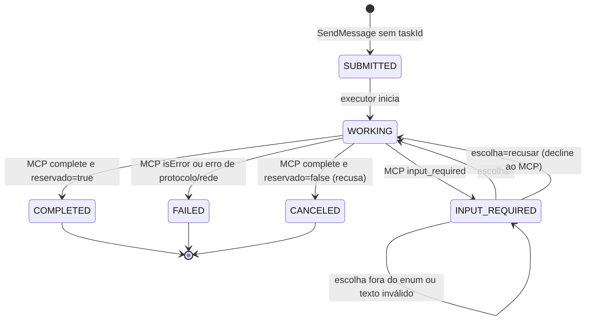
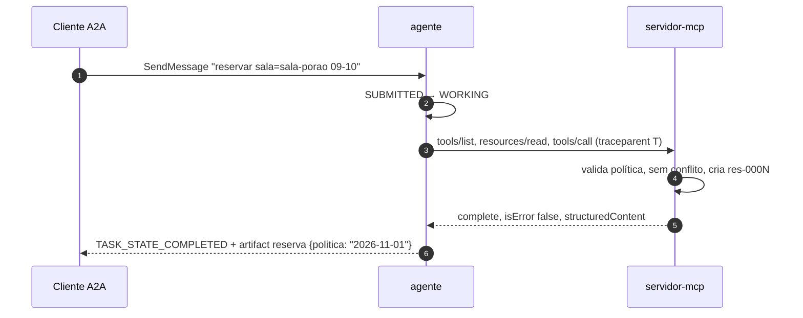
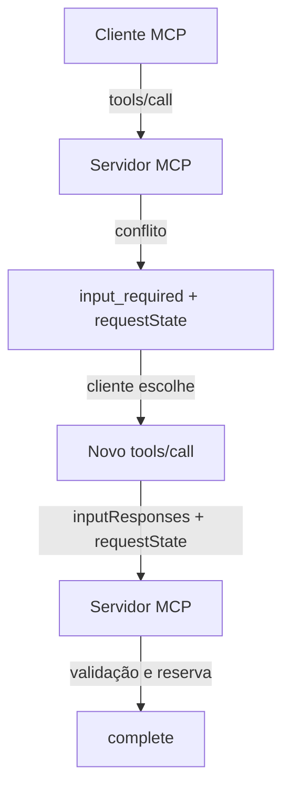
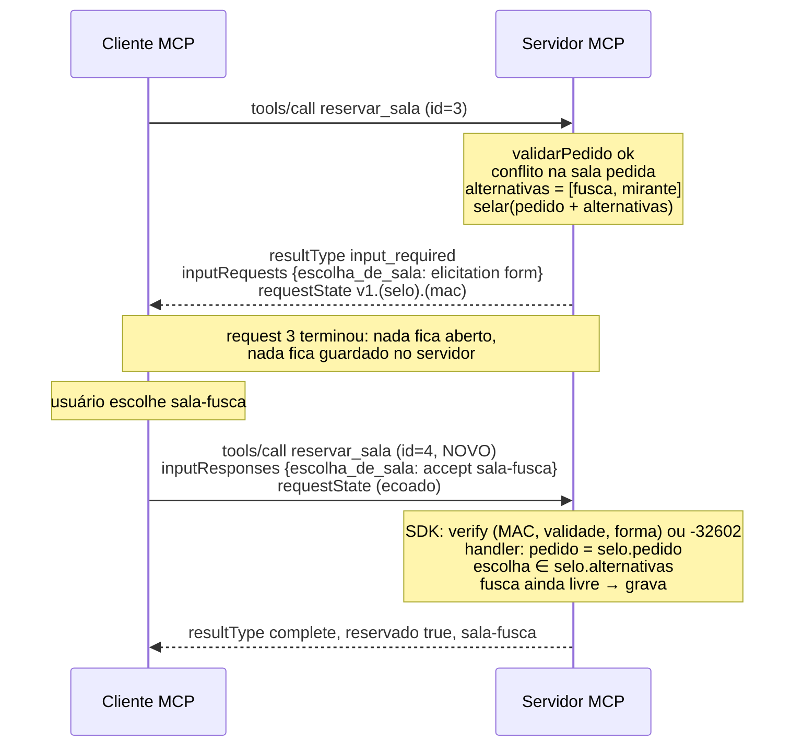

# Arquitetura: A Ponte (agente A2A com MCP por dentro)

> Documento de referência dos passos de implementação. Ele **não** substitui os contratos oficiais: `README.md` do enunciado, `exemplos/wire/` e `validador/validar.py` prevalecem em qualquer divergência. Tudo o que está aqui é **planejado**. Na data deste documento (Passo 2, 07/11/2026), `servidor-mcp/` e `agente/` contêm apenas `.gitkeep`.

---

## 1. Objetivo e escopo

Construir dois processos independentes que conversam por HTTP:

| Processo | Porta | Papel | Protocolo exposto |
|---|---|---|---|
| **servidor-mcp** | 7301 | Dono do domínio: salas, reservas, política, conflito, alternativas e MRTR | MCP `2026-07-28`, Streamable HTTP em `POST /mcp` |
| **agente** | 7300 | Tradutor de protocolo: servidor A2A por fora, host/cliente MCP por dentro | A2A v1.0, JSON-RPC em `POST /a2a` e card em `GET /.well-known/agent-card.json` |

Dentro do escopo: as 3 tools, 1 resource, os dois tipos de erro, o MRTR com `requestState` assinado, o Agent Card, `SendMessage`/`GetTask`, a pausa em `TASK_STATE_INPUT_REQUIRED`, a propagação de `traceparent` com log em stderr e o README final.

Fora do escopo (enunciado): autenticação, streaming/SSE/push, `CancelTask` como fluxo, card estendido, OpenTelemetry, banco, ORM, Docker, persistência em disco e LLM.

---

## 2. Stack escolhida: TypeScript (Node.js ≥ 22 LTS, ESM)

### 2.1 Como verifiquei

Em vez de confiar no enunciado ou na documentação, **instalei os pacotes e exercitei o wire** em um protótipo descartável fora do repositório, no ambiente de nuvem. Nada desse protótipo vai para o fork.

| Pacote | Versão publicada (07/11/2026) | Como foi verificado |
|---|---|---|
| `@modelcontextprotocol/server` | **2.4.0** (engines `node >=20`, ESM) | Servidor de teste + `curl` no formato exato do validador |
| `@modelcontextprotocol/client` | **2.4.0** | Cliente de teste em modo manual contra o servidor de teste |
| `@a2a-js/sdk` | **1.3.0** (A2A v1.0, com compat opcional v0.3) | Servidor express de teste + `curl` no formato do validador |
| `mcp` (Python) | **2.3.0** | Instalado e com o código-fonte inspecionado (`mcp/server/request_state.py`, `mcpserver/resolve.py`); **sem** teste de wire |
| `a2a-sdk` (Python) | **1.3.0** | Instalado e inspecionado; sem teste de wire |

### 2.2 O que o teste de wire comprovou no SDK TypeScript

| Comportamento exigido | Resultado observado (TS 2.4.0) | Verificação do validador |
|---|---|---|
| Resposta JSON, não SSE | `createMcpHandler(..., { responseMode: 'json' })` → `Content-Type: application/json` | todas |
| `_meta` sem `protocolVersion` | `-32602` + **HTTP 400** automático | 04 ✅ |
| `_meta` sem `clientCapabilities` | `-32602` + **HTTP 400** automático | 05 ✅ |
| Tool inexistente | `-32602 "Tool voar not found"` | 06 ✅ |
| URI inexistente | `-32602` com `data.uri` | 08 ✅ |
| Header ≠ corpo (`Mcp-Name`) | `-32020` + HTTP 400 automático | enunciado ✅ |
| Conflito → MRTR | `inputRequired({ inputRequests: { k: inputRequired.elicit({...}) }, requestState })` → `resultType: "input_required"`, `mode: "form"`, `enum` preservado | 13, 14 ✅ |
| Sem capability form | `-32021`, `data.requiredCapabilities: {elicitation:{form:{}}}`, **HTTP 400**, automático, porque o SDK confere a elicitation embutida contra o `_meta` | 15 ✅ |
| `requestState` adulterado | `createRequestStateCodec` (HMAC-SHA256) + `requestState.verify` → `-32602 "Invalid or expired requestState"` | 17 ✅ |
| Argumentos adulterados no retry | O handler lê o payload selado em `ctx.mcpReq.requestState()` e ignora os `arguments` | 18 ✅ (por desenho) |
| Mesmo `requestState` reutilizado (decline) | Aceito: o codec é stateless, não há "uso único" | 19 ✅ |
| Cliente vê o `input_required` cru | `new Client(..., { inputRequired: { autoFulfill: false } })` + `request(tools/call, withInputRequired(...), { allowInputRequired: true })` (o spike usou `callTool`; ver Passo 8) | base da ponte |
| Retry com id novo | O cliente numera sozinho (`id=2` → `id=3`) | avaliador ✅ |
| `_meta` e headers no agente | O cliente (`versionNegotiation: { pin: '2026-07-28' }`) adiciona `protocolVersion`, `clientInfo`, `clientCapabilities`, `MCP-Protocol-Version`, `Mcp-Method` e `Mcp-Name` sozinho; nosso `_meta.traceparent` é mesclado | enunciado ✅ |

### 2.3 Comparação

| Critério | TypeScript (`@modelcontextprotocol/server` 2.4.0) | Python (`mcp` 2.3.0) |
|---|---|---|
| 1. Revisão `2026-07-28` | Sim (`SUPPORTED_PROTOCOL_VERSIONS`, `legacy: 'reject'` para só aceitar a nova) | Sim |
| 2. MRTR | Primeira classe: o handler **retorna** `inputRequired(...)` | Primeira classe, mas **indireto**: resolvers `Resolve(fn)` / `Elicit[T]` por injeção de dependência; o corpo do resolver pode reexecutar a cada rodada |
| 3. `inputRequests`/`inputResponses`/`requestState` | Explícitos: `ctx.mcpReq.inputResponses`, `ctx.mcpReq.requestState<T>()` | Gerenciados pelo framework (`RequestStateBoundary`); o código da tool vê o modelo já resolvido |
| 4. Integridade do `requestState` | `createRequestStateCodec` (HMAC-SHA256, `ttlSeconds`, `bind`), **assinado**, legível | `AESGCMRequestStateCodec` (AES-256-GCM + HKDF), **cifrado** |
| 5. Streamable HTTP + JSON | `createMcpHandler` web-standard, `responseMode: 'json'` | Starlette/uvicorn |
| 6. Servidor A2A v1.0 | `@a2a-js/sdk` 1.3.0 testado: card, `SendMessage`, `GetTask` e rejeição de Task terminal (`-32004`) funcionam, **com um ajuste** (ver 2.4) | `a2a-sdk` 1.3.0 existe; não testado |
| 7. Integração das camadas | Mesma linguagem e mesmo tipo de objeto nos dois lados; o cliente MCP tem modo manual documentado | Mesma linguagem; modo manual do cliente não verificado |
| 8. Depuração | Tipos estáticos nos dois SDKs, `onerror` do servidor e stack traces de Node | Ótima; os exemplos de wire foram capturados com este SDK, então comparar byte a byte é trivial |
| 9. Validador | Todas as verificações MCP testadas passaram no formato | Esperado, porque gerou os exemplos |
| Ambiente do Igor | **Node não instalado** (precisa instalar) | Python 3.15.2 já disponível |

### 2.4 Decisão e justificativa

**TypeScript**, conforme a sua preferência, e agora com a compatibilidade **comprovada no wire**, não presumida. O fator que mais pesa a favor, além da tipagem, é didático: no SDK TS o MRTR é explícito. Você escreve o `return inputRequired(...)`, lê o `requestState` e decide o que fazer com os `inputResponses`. No SDK Python, o mesmo ciclo fica escondido atrás da injeção de resolvers. Como o objetivo do desafio é entender a costura, ver a costura no código vale mais.

O preço:

1. **Node ≥ 22 LTS precisa ser instalado no seu PC** (hoje não há Node).
2. Os exemplos de wire foram gerados pelo SDK Python, então detalhes cosméticos vão diferir: a chave do `inputRequests` (`__main__:escolha_de_sala` lá; a nossa será, por exemplo, `escolha_de_sala`), o formato do `requestState` (`v1.<corpo>.<mac>` assinado lá vs `v1.<cifrado>`), os `title` dos schemas e a mensagem do `-32021`. O enunciado aceita explicitamente essas diferenças.
3. **Achado importante no A2A:** o `@a2a-js/sdk` trata request **sem** o header `A2A-Version` como v0.3 e responde `-32009 VERSION_NOT_SUPPORTED`. O validador **nunca** envia esse header. Solução testada: um middleware de uma linha, antes do `jsonRpcHandler`, que assume `A2A-Version: 1.0` quando o header está ausente. Habilitar o `legacyCompat` seria errado, porque responderia no formato v0.3.

---

## 3. Diagrama de componentes

```mermaid
flowchart LR
    C["Cliente A2A<br/>(validador, curl, outro agente)"]

    subgraph AG["Processo B: agente :7300"]
        direction TB
        HTTP_A["main.ts<br/>express: GET card, POST /a2a<br/>middleware A2A-Version e traceparent"]
        SDK_A["@a2a-js/sdk<br/>DefaultRequestHandler<br/>+ InMemoryTaskStore"]
        EXE["executor.ts<br/>AgentExecutor: publica eventos da Task"]
        PONTE["ponte.ts<br/>traduz resultType em TaskState"]
        RET[("retomadas.ts<br/>Map taskId → requestState,<br/>chave, enum, args")]
        CLI["mcp/cliente.ts<br/>Client SDK em modo manual<br/>tools/list, resources/read, tools/call"]
        TR["trace.ts<br/>AsyncLocalStorage + traceparent"]
        HTTP_A --> SDK_A --> EXE --> PONTE
        PONTE <--> RET
        PONTE --> CLI
        TR -.-> CLI
        HTTP_A -.-> TR
    end

    subgraph MS["Processo A: servidor-mcp :7301"]
        direction TB
        HTTP_M["main.ts<br/>node:http, log stderr,<br/>handler.fetch"]
        SRV["servidor.ts<br/>McpServer por request<br/>tools + resource + verify"]
        TOOLS["tools/*.ts<br/>adaptadores finos"]
        RS["estado-mrtr.ts<br/>createRequestStateCodec<br/>REQUEST_STATE_SECRET"]
        DOM["dominio/regras.ts<br/>validação, conflito, alternativas"]
        AGD[("dominio/agenda.ts<br/>salas + reservas em memória<br/>singleton do processo")]
        HTTP_M --> SRV --> TOOLS --> DOM --> AGD
        TOOLS --> RS
    end

    D[("dados/<br/>salas.json, reservas.json,<br/>politica-de-uso.md")]

    C -- "HTTP POST /a2a<br/>JSON-RPC A2A v1.0<br/>header traceparent" --> HTTP_A
    CLI -- "HTTP POST /mcp<br/>JSON-RPC MCP 2026-07-28<br/>_meta + headers espelho" --> HTTP_M
    AGD -. "lido 1x ao subir" .-> D
    SRV -. "politica://uso" .-> D
```



O que atravessa cada fronteira:

- **Cliente ↔ agente:** texto fixo (`reservar ...`, `escolha=...`) dentro de mensagens A2A, `taskId`, `contextId` e o header `traceparent`.
- **Agente ↔ MCP:** `arguments`, `inputResponses`, `requestState` (opaco) e `_meta.traceparent`.
- **Nunca atravessa:** regras de sala para o agente, `requestState` para o cliente A2A e segredo para qualquer lado.

---

## 4. Estrutura de diretórios

Cada processo tem o **próprio** `package.json` e `package-lock.json`. Não há workspace nem código compartilhado, e é isso que torna "dois processos" literal: nada do agente importa algo do servidor.

```
.
├── README.md                    (substituído no fim)
├── ARQUITETURA.md               (este documento)
├── dados/ validador/ exemplos/  (🔒 intocados)
├── servidor-mcp/
│   ├── package.json             versões exatas, "type": "module", scripts start/check
│   ├── package-lock.json
│   ├── tsconfig.json
│   ├── test/
│   │   ├── contrato.test.ts     testes de contrato: sobe o processo real e conversa por HTTP (node:test)
│   │   ├── regras.test.ts       testes unitários das regras de domínio (funções puras)
│   │   ├── agenda.test.ts       testes unitários da agenda em memória, dos ids e da versão da política
│   │   ├── estado-mrtr.test.ts  testes unitários do requestState (MAC, expiração com relógio simulado) e do segredo
│   │   └── mrtr.test.ts         MRTR por HTTP contra o processo real, incluindo restart
│   └── src/
│       ├── main.ts              sobe node:http na 7301, loga cada request no stderr, delega a handler.fetch
│       ├── config.ts            lê e valida env (porta, DADOS_DIR, REQUEST_STATE_SECRET ≥ 32 bytes, TTL)
│       ├── servidor.ts          factory do McpServer: registra tools/resource, liga requestState.verify
│       ├── estado-mrtr.ts       codec HMAC (mint/verify) e o tipo do payload selado
│       ├── log.ts               log estruturado em uma linha no stderr
│       ├── tools/
│       │   ├── listar-salas.ts
│       │   ├── consultar-disponibilidade.ts
│       │   └── reservar-sala.ts      o único ponto com MRTR
│       ├── recursos/
│       │   └── politica.ts           politica://uso, text/markdown
│       └── dominio/
│           ├── agenda.ts             carrega dados/, guarda reservas em memória, gera res-NNNN
│           └── regras.ts             validações, conflito, alternativas, mensagens exatas (funções puras)
└── agente/                      (✅ = existe desde o Passo 8; o resto é planejado)
    ├── package.json             ✅
    ├── package-lock.json        ✅
    ├── tsconfig.json            ✅
    ├── src/
    │   ├── main.ts              express na 7300: card, /a2a, middlewares (A2A-Version, traceparent)
    │   ├── config.ts            ✅ MCP_URL, versão e capabilities do cliente (+ porta e A2A_PUBLIC_URL depois)
    │   ├── card.ts              Agent Card v1.0 (espelho de exemplos/wire/07)
    │   ├── executor.ts          AgentExecutor do SDK A2A: recebe mensagem e publica estado/artifact
    │   ├── pedido.ts            parser do texto fixo; não é regra de domínio, é formato de entrada
    │   ├── ponte.ts             coordenador MCP ↔ A2A (seção 9)
    │   ├── retomadas.ts         Map<taskId, ContextoRetomada>, privado, nunca serializado para fora
    │   ├── trace.ts             ✅ parse/validação de traceparent e span filho (+ AsyncLocalStorage depois)
    │   ├── demo.ts              ✅ demonstração de terminal do cliente MCP (Passo 8)
    │   └── mcp/
    │       ├── cliente.ts       ✅ Client do SDK: conecta 1x, descobre, lê resource, tools/call genérico
    │       ├── resultado.ts     ✅ completo × erro_execucao × input_required, com o resultado bruto
    │       ├── erros.ts         ✅ ErroMcp (jsonrpc / transporte / resposta) e ErroDeUso
    │       ├── mrtr.ts          ✅ lê inputRequests, valida a resposta, monta inputResponses
    │       ├── politica.ts      ✅ URI da política e extração da versão (\r?\n)
    │       └── observacao.ts    ✅ fetch que registra o tráfego (testes e demo)
    └── test/                    ✅ unidade.test.ts, integracao.test.ts, apoio.ts
```

Por que essa granularidade:

- **`dominio/` separado de `tools/`:** as regras são funções puras e testáveis sem MCP. As tools só convertem `{args}` em domínio e domínio em `{content, structuredContent, isError}`. É a mesma regra do enunciado ("o agente traduz protocolo, não domínio") aplicada também dentro do servidor.
- **`agenda.ts` é singleton do módulo:** o `createMcpHandler` cria um `McpServer` **por request** (stateless), mas as reservas precisam sobreviver entre requests do mesmo processo. Guardar a agenda dentro da factory zeraria tudo a cada chamada. Esse é o erro mais provável do Passo 3.
- **Sem camada de "service", "repository interface" ou DI:** dois arquivos de domínio bastam para cinco salas.
- **`retomadas.ts` separado do TaskStore do SDK:** o TaskStore é serializado nas respostas A2A (`GetTask`). Se o `requestState` fosse para `task.metadata`, ele vazaria e reprovaria a verificação 34.
- **Arquivos vazios não serão criados agora.** A árvore acima é o plano; cada arquivo nasce no passo que o implementa.

---

## 5. Responsabilidades por processo

| Responsabilidade | servidor-mcp | agente |
|---|---|---|
| Endpoint | `POST /mcp` | `GET /.well-known/agent-card.json`, `POST /a2a` |
| Validação de `_meta` e headers | **SDK** (`-32602`/`-32020`, 400) | **emite** via SDK cliente |
| Ler `dados/` | ✅ (uma vez ao subir) | ❌ nunca |
| Regras: janela, duração, intervalo, sala | ✅ `regras.ts` | ❌ |
| Conflito e alternativas | ✅ | ❌ (só repete o `enum` recebido) |
| Gerar e verificar `requestState` | ✅ `estado-mrtr.ts` | ❌ guarda e ecoa, **nunca abre** |
| Capability form | conferida pelo SDK (`-32021`) | **declara** `{elicitation:{form:{}}}` |
| Task: criar, estado, histórico, artifact | ❌ | ✅ SDK A2A + `executor.ts` |
| Validar `escolha` contra o `enum` | também valida (defesa) | ✅ antes de chamar o MCP |
| Versão da política no artifact | serve o resource | ✅ lê `politica://uso` e extrai a 1ª linha |
| `traceparent` | **loga** | **propaga** (mesmo trace-id, span novo) |
| Log stderr | método, id, traceparent, eventos MRTR | estado das Tasks, ids MCP emitidos |

---

## 6. Contratos de comunicação MCP (agente → servidor)

### 6.1 Ciclo de vida do cliente

1. Na primeira necessidade, o agente cria **um** `Client` e chama `connect()` com `versionNegotiation: { mode: { pin: '2026-07-28' } }`, `capabilities: { elicitation: { form: {} } }` e `inputRequired: { autoFulfill: false }`.
   - O `connect()` envia um `server/discover`. Ele aparecerá no log do servidor e não é sessão: só confirma a revisão.
   - **Não** registramos handler de `elicitation/create`. Sem handler e com `autoFulfill: false`, o SDK nunca responde sozinho.
2. O objeto `Client` é reutilizado entre Tasks. Isso é estado de **processo**, não de protocolo: cada request leva o próprio `_meta` completo, e o servidor não lembra de nada. Se o servidor MCP reiniciar, o próximo request funciona igual.

### 6.2 Requests emitidos por Task

| Momento | Método | Headers (pelo SDK) | `_meta` (pelo SDK + nosso) | Observação |
|---|---|---|---|---|
| Início da Task | `tools/list` | `MCP-Protocol-Version`, `Mcp-Method` | `protocolVersion`, `clientInfo`, `clientCapabilities`, **`traceparent`** | Descoberta: confere que `reservar_sala` existe, sem lista fixa no código |
| Início da Task | `resources/read politica://uso` | + `Mcp-Name: politica://uso` | idem | Extrai `versao: AAAA-MM-DD` da 1ª linha |
| Pedido | `tools/call reservar_sala` | + `Mcp-Name: reservar_sala` | idem | `request(tools/call, withInputRequired(CallToolResult), { allowInputRequired: true })` (ver Passo 8: o `callTool` da 2.4.0 não serve no modo manual) |
| Retomada | `tools/call reservar_sala` | idem | idem | Mesmo `name`/`arguments` + `inputResponses` + `requestState` ecoado; **id novo gerado pelo SDK** |

Decisão: fazer descoberta e leitura da política **a cada Task nova**, e não só ao subir. O custo é desprezível; o log fica com `tools/list` → `resources/read` → `tools/call` sob o mesmo trace-id, que é exatamente o que o avaliador procura; e o agente continua correto se o MCP for reiniciado.

### 6.3 Consistência header ↔ corpo

Nós **não** escrevemos esses headers à mão. O transporte do SDK cliente deriva `Mcp-Method`, `Mcp-Name` e `MCP-Protocol-Version` do próprio corpo que ele serializa, e o SDK servidor rejeita divergência com `-32020`. A garantia vem de ter uma única fonte (o objeto do request) e de os dois lados usarem o SDK. O único campo que injetamos é `_meta.traceparent`, que não tem header espelho.

### 6.4 Ids JSON-RPC

São gerados pelo SDK cliente, monotônicos por instância (`0, 1, 2, 3…`). Como o retry é um `tools/call` **novo**, ele recebe um id novo automaticamente. Nunca passamos id manualmente.

---

## 7. Modelo de Task A2A

### 7.1 Estrutura

O que é público (serializado em `SendMessage`/`GetTask`) é gerido pelo `InMemoryTaskStore` do SDK:

```ts
Task {
  id: string                 // gerado pelo SDK (UUID) no 1º SendMessage sem taskId
  contextId: string          // idem
  status: { state: TaskState, message?: Message }   // message = última fala do agente
  history: Message[]         // usuário e agente, em ordem
  artifacts: Artifact[]      // [{ artifactId, name: "reserva", parts: [{ text: "<json>" }] }]
}
```

O que é privado e nunca sai do processo fica no `retomadas.ts`:

```ts
ContextoRetomada {
  taskId: string
  ferramenta: "reservar_sala"     // nome descoberto no tools/list
  argumentos: {...}               // os mesmos do 1º tools/call
  chave: string                   // a chave única de inputRequests
  alternativas: string[]          // o enum, na ordem recebida
  requestState: string            // opaco, byte a byte
  politica: string                // versão lida no início da Task
  traceId: string                 // trace-id de origem, se não vier header na continuação
}
```

### 7.2 Transições



Um ajuste em relação ao seu rascunho: a recusa também passa por `WORKING`, porque o agente **precisa** fazer o retry com `decline` para o MCP. É o MCP que conclui o MRTR. O `CANCELED` sai do `complete` com `reservado: false`, e não de um atalho no agente.

### 7.3 Respostas às sete perguntas

1. **Quem cria a Task?** O `DefaultRequestHandler` do SDK A2A, ao receber `SendMessage` sem `taskId`. Nosso executor publica o evento `task` inicial (`SUBMITTED`, com a mensagem do usuário no `history`).
2. **Identidade?** `id` e `contextId` são UUIDs gerados pelo SDK. Os exemplos usam `task-xxxx`, mas o validador não exige formato.
3. **Onde fica o estado?** Em memória, no `InMemoryTaskStore` (público) e no `Map` de `retomadas.ts` (privado). Nenhum dos dois sobrevive a restart do **agente**, e o enunciado não exige isso. Só o restart do **MCP** precisa ser suportado, e lá o estado viaja no `requestState`.
4. **`GetTask`?** O SDK lê o TaskStore e devolve o snapshot. O executor não participa.
5. **Retomada?** `SendMessage` com `message.taskId`: o SDK encontra a Task e chama o executor com `requestContext.task` preenchido em `INPUT_REQUIRED`. O executor pede à ponte `retomar(taskId, texto)`.
6. **Terminal?** O próprio SDK rejeita (`-32004 UNSUPPORTED_OPERATION`, testado), o que cobre a verificação 31. Como defesa extra, a ponte apaga a `ContextoRetomada` ao chegar a um estado terminal, então não há o que retomar.
7. **Duas Tasks pausadas?** Cada uma tem sua entrada no `Map`, indexada por `taskId`. Não existe variável "Task atual", nem `requestState` global, nem fila. A verificação 33 cobre isso.

---

## 8. Gerenciamento de estado

### 8.1 Dois mecanismos, dois donos

| | Estado da Task A2A | `requestState` MCP |
|---|---|---|
| Dono | agente | servidor MCP (quem cria), agente (quem carrega) |
| Onde vive | memória do agente | **dentro da mensagem**, entre um request e o próximo |
| Conteúdo | identidade, estado, histórico, artifact, contexto de retomada | o pedido original selado: argumentos, alternativas calculadas, chave |
| Integridade | não precisa: nunca sai do agente | HMAC-SHA256 com `REQUEST_STATE_SECRET`; adulterado → `-32602` |
| Validade | até terminar ou o processo cair | TTL de 15 min (dentro de 5–30); expirado → `-32602` |
| Sobrevive a restart | do agente: não (não exigido) | do MCP: **sim**, porque a chave vem do ambiente e o estado viaja no token |
| Quem pode ler | agente e cliente A2A (o que é público) | só o servidor. Para o agente é **opaco**: guarda e ecoa, nunca decodifica, mesmo sendo base64 legível |

### 8.2 Payload selado (implementado no Passo 7, `src/estado-mrtr.ts`)

```ts
SeloReserva = {
  v: 1,                                        // versão do formato do selo
  ferramenta: 'reservar_sala',                 // um selo de reservar_sala só serve para ela
  pedido: { sala, inicio, fim, responsavel },  // o pedido original: fonte da verdade no retry
  alternativas: string[],                      // o enum oferecido: valida a escolha recebida
  chave: 'escolha_de_sala',                    // a chave de inputRequests esperada em inputResponses
  emitidoEm: number,                           // unix s
}
// o exp é colocado pelo codec (ttlSeconds); o verify também confere a forma (zod, .strict())
```

No retry, o handler usa `ctx.mcpReq.requestState<SeloReserva>()`, já verificado pelo SDK, e **ignora** `params.arguments` (verificação 18). A escolha em `inputResponses` também é entrada não confiável: o servidor confere se ela está em `selo.alternativas` antes de reservar.

### 8.3 Por que nada disso é sessão

Sessão de **transporte/protocolo** seria o servidor lembrar algo **da conexão ou do cliente** entre requests, como versão negociada, capabilities ou "em que pergunta estávamos". Isso é proibido aqui: cada request MCP leva `_meta` completo, e o servidor reconstrói o contexto **do próprio request** (`requestState`).

Estado de **aplicação** é outra coisa:

- as reservas em memória do MCP são o dado de negócio;
- a Task do agente é um recurso com identidade, nomeado explicitamente pelo cliente via `taskId`.

Nenhum dos dois depende de conexão aberta ou de request anterior para **interpretar** o request atual. É o que o enunciado chama de "estado nomeado explicitamente". A Task é nomeada pelo `taskId`; o pedido pendente é nomeado pelo `requestState`.

---

## 9. A ponte MCP/A2A (`ponte.ts`)

### 9.1 Contrato do componente

```ts
iniciar(taskId, pedido: PedidoReserva): Promise<Desfecho>
retomar(taskId, texto: string): Promise<Desfecho>

type Desfecho =
  | { tipo: 'concluida', reserva: {...}, mensagem: string }     // → COMPLETED + artifact
  | { tipo: 'pausada', linha: 'alternativas: a, b' }            // → INPUT_REQUIRED
  | { tipo: 'cancelada', mensagem: string }                     // → CANCELED
  | { tipo: 'falhou', mensagem: string }                        // → FAILED (texto exato da tool)
```

O executor converte `Desfecho` em eventos A2A. A ponte não conhece eventos A2A, e o executor não conhece MCP. A ponte é o único arquivo que conhece os dois vocabulários: `resultType` e `isError` de um lado, os quatro desfechos do outro.

### 9.2 Passo a passo (os 11 itens do Passo 2)

1. **Recebe** `PedidoReserva`, já parseado por `pedido.ts`.
2. **Aciona** o cliente MCP: `tools/list` (confere a tool), `resources/read` (versão) e `tools/call`.
3. **Interpreta:** `resultType === 'input_required'`, ou `isError === true`, ou `complete`.
4. **Atualiza:** devolve o `Desfecho`, e o executor publica o novo status.
5. **Guarda:** em `input_required`, grava `ContextoRetomada` com chave, `enum` (de `requestedSchema.properties.sala.enum` ou `const`), `requestState` e argumentos.
6. **Não bloqueia:** o request A2A original **termina** devolvendo a Task em `INPUT_REQUIRED`. Nenhuma promise, conexão ou timer fica aberto esperando.
7. **Valida** `escolha=X`: `X === 'recusar'` ou `X ∈ enum`. Qualquer outra coisa → `pausada` com a **mesma** linha, sem chamar o MCP.
8. **Prepara** `inputResponses = { [chave]: { action: 'accept', content: { sala: X } } }` ou `{ [chave]: { action: 'decline' } }`.
9. **Recupera** o `requestState` do `Map`, intacto.
10. **Novo `tools/call`:** um `tools/call` novo (`ClienteMcp.continuar`) com os mesmos `name`/`arguments` + `inputResponses` + `requestState`. O SDK atribui o id novo.
11. **Traduz:** `complete` com `reservado: true` → `concluida`; `reservado: false` → `cancelada`; `isError` → `falhou`; outro `input_required` → `pausada` de novo (defensivo). Em estado terminal, apaga a `ContextoRetomada`.

### 9.3 Sequência com conflito e escolha

```mermaid
sequenceDiagram
    autonumber
    participant C as Cliente A2A
    participant E as agente: SDK A2A + executor
    participant P as agente: ponte.ts
    participant R as agente: retomadas (Map)
    participant K as agente: mcp/cliente.ts
    participant M as servidor-mcp

    C->>E: POST /a2a SendMessage (sem taskId)<br/>"reservar sala=sala-garagem ..."<br/>header traceparent 00-T-S0-01
    E->>E: Task criada: SUBMITTED → WORKING
    E->>P: iniciar(taskId, pedido)
    P->>K: descobrir + lerPolitica
    K->>M: tools/list (id=1), resources/read (id=2)<br/>_meta.traceparent 00-T-S1-01
    M-->>K: tools[], "versao: 2026-11-01"
    P->>K: chamar reservar_sala
    K->>M: tools/call (id=3)
    rect rgba(255,200,0,0.15)
    M-->>K: ① AQUI CHEGA O input_required<br/>{inputRequests:{k: form enum[...]}, requestState: RS}
    K-->>P: resultado cru (allowInputRequired)
    P->>R: ② AQUI O requestState É ARMAZENADO<br/>R[taskId] = {k, enum, RS, args, politica, T}
    P-->>E: Desfecho pausada("alternativas: sala-fusca, sala-mirante")
    E-->>C: ③ AQUI A TASK VAI PARA TASK_STATE_INPUT_REQUIRED<br/>(o request HTTP termina)
    end
    Note over C,M: Ninguém espera. O estado A2A está no TaskStore; o de domínio está em RS.
    C->>E: SendMessage {taskId, "escolha=sala-fusca"}
    E->>E: INPUT_REQUIRED → WORKING
    E->>P: retomar(taskId, "escolha=sala-fusca")
    P->>R: ler R[taskId]
    P->>P: sala-fusca ∈ enum? sim<br/>inputResponses = {k: accept {sala}}
    rect rgba(0,160,255,0.12)
    P->>K: ④ AQUI ACONTECE O RETRY
    K->>K: ⑤ AQUI O SDK GERA O NOVO ID JSON-RPC (id=4)
    K->>M: tools/call (id=4) args + inputResponses + requestState RS
    end
    M->>M: verify(RS) e lê o selo; ignora args do corpo
    M-->>K: complete, structuredContent {reserva, sala-fusca, ...}
    P->>R: delete R[taskId]
    P-->>E: Desfecho concluida
    E-->>C: TASK_STATE_COMPLETED + artifact "reserva" {..., politica}
```

### 9.4 Fluxo feliz (sem conflito)



---

## 10. Tratamento de erros

### 10.1 Servidor MCP

| Situação | Tipo | Quem produz | Wire |
|---|---|---|---|
| `_meta` sem `protocolVersion`/`clientCapabilities` | Protocolo | **SDK** | `-32602`, HTTP 400 |
| Header ≠ corpo | Protocolo | **SDK** | `-32020`, HTTP 400 |
| Elicitation sem capability form | Protocolo | **SDK** (confere o `inputRequired` retornado) | `-32021`, `data.requiredCapabilities`, HTTP 400 |
| `requestState` inválido/expirado | Protocolo | **SDK** + nosso codec | `-32602` "Invalid or expired requestState" |
| Tool inexistente | Protocolo | **SDK** | `-32602` |
| Resource inexistente | Protocolo | **SDK** | `-32602` com `data.uri` |
| Sala inexistente, janela, duração, intervalo, sem alternativas | **Execução** | **nós** (`regras.ts`) | `result.isError: true`, mensagem exata em `content[0].text` |
| Recusa (`decline`/`cancel`) | **Não é erro** | nós | `complete`, `reservado: false`, `motivo: "recusado"` |
| Exceção inesperada no handler | Execução | SDK converte | `isError: true` (genérico), e logamos no stderr |

Regra prática: **o que é sobre o request vem do SDK; o que é sobre o domínio, nós escrevemos.** Nunca lançamos exceção para erro de domínio; retornamos `isError`.

### 10.2 Agente (A2A)

| Situação | Resultado A2A |
|---|---|
| Tool devolve `isError` | `FAILED`, com `status.message` = texto exato da tool (o validador lê **`status.message`**, verificação 35) |
| MCP devolve erro JSON-RPC ou está fora do ar | `FAILED`, com mensagem descritiva. Ver risco R6 |
| `complete` com `reservado: false` | `CANCELED` |
| `input_required` | `INPUT_REQUIRED`, mensagem `alternativas: …` |
| Escolha fora do enum / texto não reconhecido | permanece `INPUT_REQUIRED`, **mesma** linha |
| Texto inicial fora do formato `reservar ...` | `FAILED` com mensagem de formato (decisão de produto nossa, não testada) |
| `SendMessage` em Task terminal | erro JSON-RPC pelo SDK (`-32004`) |
| `taskId` inexistente | erro JSON-RPC pelo SDK (`TaskNotFound`) |

Erros MCP aparecem no histórico porque a mensagem de status de cada transição é também anexada ao `history` pelo SDK. A linha `alternativas: …` é **sempre** construída como `"alternativas: " + enum.join(", ")`, sem nada antes nem depois.

---

## 11. Propagação de `traceparent` e observabilidade

Formato W3C: `00-<trace-id 32 hex>-<parent/span-id 16 hex>-<flags 2 hex>`.

1. Um middleware express no agente lê o header `traceparent` e valida o formato. Se for válido, guarda `{traceId, flags}` num `AsyncLocalStorage` durante o request.
2. Em cada request MCP, `mcp/cliente.ts` monta `00-<mesmo traceId>-<span novo aleatório>-<flags>` e o coloca em `_meta.traceparent`.
3. Se o header **não** vier (as verificações 29, 32, 33 e 36 não mandam), usa-se o `traceId` guardado na `ContextoRetomada` da Task. Se for Task nova sem header, gera-se um trace-id novo para a Task inteira.
4. O servidor MCP loga o `traceparent` de `_meta`.

Formato de log planejado (uma linha por evento, stderr):

```
[mcp] recv method=tools/call id=4 name=reservar_sala traceparent=00-4bf9…-a1b2…-01
[mcp] mrtr evento=conflito id=3 chave=escolha_de_sala alternativas=sala-fusca,sala-mirante
[mcp] mrtr evento=retry id=4 resultado=accept escolha=sala-fusca
[mcp] rejeitado tipo=Error mensagem="requestState verification rejected tools/call: mac"
[agente] task=3c3a… SUBMITTED→WORKING traceId=4bf9…
[agente] task=3c3a… mcp tools/call id=3 → input_required
[agente] task=3c3a… WORKING→INPUT_REQUIRED
```

O log do servidor é feito **na borda HTTP**, em `main.ts`, antes do SDK: o corpo é lido, logado e repassado para `handler.fetch(new Request(...))`. Assim até os requests rejeitados pelo SDK (`-32602`/`-32020`) aparecem no log. Nunca logamos `REQUEST_STATE_SECRET` nem o `requestState` (nem um pedaço dele): do retry só aparecem o id, o resultado e a escolha, e de uma recusa só o código opaco do codec (`mac`, `expired`, `malformed`).

---

## 12. Configuração e inicialização

### 12.1 Variáveis de ambiente

| Variável | Processo | Padrão | Obrigatória |
|---|---|---|---|
| `MCP_PORT` | servidor-mcp | `7301` | não |
| `DADOS_DIR` | servidor-mcp | `../dados` (relativo ao pacote) | não |
| `REQUEST_STATE_SECRET` | servidor-mcp | — | **sim**: hex com ≥ 64 dígitos (32 bytes); o processo **não sobe** sem ela |
| `REQUEST_STATE_TTL_SECONDS` | servidor-mcp | `900` (15 min) | não (validado entre 300 e 1800) |
| `AGENTE_PORT` | agente | `7300` | não |
| `MCP_URL` | agente | `http://localhost:7301/mcp` | não |
| `A2A_PUBLIC_URL` | agente | `http://localhost:7300/a2a` | não (vai no card) |

Nenhum segredo vai para o repositório. O `.gitignore` do starter já ignora `.env`.

### 12.2 Versões a travar (exatas, sem `^`)

| Pacote | servidor-mcp | agente |
|---|---|---|
| `@modelcontextprotocol/server` | 2.4.0 | — |
| `@modelcontextprotocol/client` | — | 2.4.0 |
| `@a2a-js/sdk` | — | 1.3.0 |
| `express` | — | 5.3.0 |
| `zod` | 4.6.7 | — (se necessário) |
| `tsx` (dev, executa TS) | 4.23.15 | 4.23.15 |
| `typescript` (dev, só checagem de tipos) | 7.0.2 | 7.0.2 |
| `@types/node` (dev) | 22.20.5 | 22.20.5 |

Os `package-lock.json` são commitados, e `npm ci` reproduz a instalação. `"engines": { "node": ">=22" }`.

Testes usam o `node:test` nativo do Node (executado via `node --import tsx --test`), sem framework adicional.

A opção por `tsx` em vez de `tsc` + `dist/` é pela simplicidade: um comando só, sem etapa de build, e com stack traces apontando para o `.ts`. A checagem de tipos fica em um script `check` separado.

### 12.3 Subida a partir de um clone limpo (planejado)

```powershell
# Terminal 1: servidor MCP
cd servidor-mcp
npm ci
$env:REQUEST_STATE_SECRET = python -c "import secrets; print(secrets.token_hex(32))"
npm start                     # escuta em :7301, logs no stderr

# Terminal 2: agente
cd agente
npm ci
npm start                     # escuta em :7300

# Terminal 3: validador (com os dois processos recém-iniciados)
python validador/validar.py --agente http://localhost:7300 --mcp http://localhost:7301
```

O equivalente em bash usa `export REQUEST_STATE_SECRET=...`. A ordem de subida não importa, porque o agente só conecta ao MCP na primeira Task.

---

## 13. Decisões técnicas e trade-offs

| # | Decisão | Justificativa | Alternativa considerada | Trade-off |
|---|---|---|---|---|
| D1 | TypeScript nos dois processos | MRTR explícito no SDK; tipagem; sua preferência; wire testado | Python (`mcp` 2.3.0) | Exige instalar Node; diferenças cosméticas com os exemplos |
| D2 | `createMcpHandler` + `responseMode: 'json'` + `legacy: 'reject'` | O validador só lê JSON; só servimos a revisão 2026-07-28 | `auto` (pode virar SSE); `stateless` legacy | Notificações no meio da chamada são descartadas (não usamos) |
| D3 | `node:http` puro no MCP, com log na borda | Logar **todo** request, inclusive os rejeitados; sem dependência extra | `@modelcontextprotocol/node` (`toNodeHandler`) | ~20 linhas de adaptação Request/Response nossas |
| D4 | `createRequestStateCodec` do SDK (HMAC, TTL 600 s) | Utilitário oficial; adulteração → `-32602` automático | HMAC manual; AES-GCM | Payload legível (permitido pelo enunciado) |
| D5 | Selo contém args + alternativas; o retry ignora `arguments` | Verificação 18; alternativas para validar a escolha | Rejeitar se os args divergirem | Menos mensagens de erro, mais robusto |
| D6 | Agenda como singleton de módulo | A factory do McpServer é por request | Estado dentro da factory | Precisa de cuidado com import/ciclo de vida |
| D7 | Cliente MCP do SDK em modo manual | Ver o `input_required` cru (a Task precisa pausar) | `fetch` à mão; auto-fulfill | Depende de API nova (`allowInputRequired`) |
| D8 | `tools/list` + `resources/read` a cada Task | Log claro por trace; resiliente a restart do MCP | Uma vez no boot | 2 requests extras por Task (irrelevante) |
| D9 | `@a2a-js/sdk` com `DefaultRequestHandler` + `InMemoryTaskStore` | Máquina de estados, histórico, `GetTask` e rejeição de terminal prontos e conformes à v1.0 | JSON-RPC A2A à mão | Precisa do middleware `A2A-Version`; menos controle byte a byte do JSON |
| D10 | Contexto de retomada fora do TaskStore | O TaskStore é serializado → evitaria vazar o `requestState` (verificação 34) | `task.metadata` | Dois lugares de estado por Task, ligados por `taskId` |
| D11 | Agente valida a escolha contra o `enum` antes de chamar o MCP | Verificação 29 (manter pausa sem efeitos); é validação de schema, não regra de sala | Mandar ao MCP e deixar falhar | O MCP também revalida (defesa em profundidade) |
| D12 | `tsx` para executar, sem build | Menos peças; README curto | `tsc` → `dist/` | Startup um pouco mais lento |
| D13 | Cada processo com o próprio `package.json` | Separação literal; `npm ci` independente | npm workspaces na raiz | Duas instalações |

---

## 14. Riscos conhecidos

| # | Risco | Mitigação / quando validar |
|---|---|---|
| R1 | SDKs muito novos (MCP 2.4.0, A2A 1.3.0): APIs podem mudar | Versões travadas e lockfile; o spike já confirmou os pontos críticos |
| R2 | Middleware `A2A-Version` esquecido → `-32009` em todas as chamadas A2A | Primeira coisa do passo do agente; teste com `curl` sem o header |
| R3 | Acesso ao header `traceparent` dentro do executor (o `ServerCallContext` do SDK não o expôs no spike) | `AsyncLocalStorage` preenchido por middleware express; confirmar no passo do agente |
| R4 | Agenda recriada a cada request (factory) | Singleton de módulo; teste: reservar e consultar em seguida |
| R5 | Escolha válida, mas a sala foi ocupada entre a pausa e o retry | Servidor revalida a disponibilidade no retry e, se a escolhida foi ocupada, devolve um **novo** `input_required` com as alternativas que sobraram (ou "Sem alternativas..."). Resolvido no Passo 7, com teste |
| R6 | MCP fora do ar durante uma Task | A Task vai para `FAILED` com mensagem clara; não é exigido |
| R7 | Windows: `localhost` resolvendo `::1` vs `127.0.0.1` | `listen()` sem host (dual-stack) nos dois processos |
| R8 | Validador rodado duas vezes sem reiniciar → falsos negativos | Documentar no README; reiniciar sempre |
| R9 | Git fora do PATH e Node ausente no PC | Pendências de ambiente (seção 16) |
| R10 | `server/discover` no log pode confundir quem procura `tools/list` | Esperado: o avaliador procura `tools/list` **antes do primeiro `tools/call`**, e isso continua verdadeiro |

---

## 15. Componentes × verificações do validador

| Verificações | Componente responsável | Principal ponto de atenção |
|---|---|---|
| 01–02 | `servidor.ts` + `tools/*` (schemas zod) | Nomes exatos; `inputSchema` objeto |
| 03 | `tools/listar-salas.ts` | `text = JSON.stringify(structuredContent)` |
| 04–05, 15 | **SDK** servidor | Só conferir que nada nosso intercepta antes |
| 06, 08 | **SDK** servidor | — |
| 07 | `recursos/politica.ts` | Conteúdo do arquivo, `text/markdown` |
| 09–12, 20 | `dominio/regras.ts` | Mensagens exatas; ordem das validações; comparar instantes |
| 13–14 | `tools/reservar-sala.ts` + `regras.ts` (alternativas) | Ordem capacidade → id, máximo 3 |
| 16, 18, 19 | `reservar-sala.ts` + `estado-mrtr.ts` | Usar o selo, não os args; escolha ∈ alternativas; `decline` → `reservado:false` |
| 17 | `estado-mrtr.ts` (codec) | `REQUEST_STATE_SECRET` do ambiente |
| 21–23 | `agente/card.ts` + `main.ts` | `supportedInterfaces`, skill `reservar-sala` |
| 24–26 | `executor.ts` + `ponte.ts` + `mcp/cliente.ts` | Artifact `reserva` com `politica` do resource |
| 27–28, 36 | `ponte.ts` | Linha `alternativas:` byte a byte e determinística |
| 29 | `ponte.ts` (validação contra enum) | Sem chamar o MCP |
| 30, 32 | `ponte.ts` (retry) | id novo, mesma chave, RS intacto; `recusar` → `decline` → `CANCELED` |
| 31 | **SDK** A2A | `-32004` |
| 33 | `retomadas.ts` | Isolamento por `taskId` |
| 34 | `retomadas.ts` (fora do TaskStore) | O RS nunca em mensagem, artifact ou metadata |
| 35 | `ponte.ts` + `executor.ts` | Mensagem exata em `status.message` |
| Avaliador (log) | `servidor-mcp/main.ts` + `agente/trace.ts` | `tools/list` antes do `tools/call`; trace-id; ids distintos |
| Avaliador (restart) | `estado-mrtr.ts` | Segredo do ambiente, selo autossuficiente |

---

## 16. Pré-requisitos para o Passo 3

- [ ] Instalar **Node.js LTS ≥ 22** no PC (`winget install OpenJS.NodeJS.LTS`) e conferir `node -v` / `npm -v` em um terminal novo.
- [ ] Colocar o **Git no PATH** do usuário (`C:\Program Files\Git\cmd`).
- [ ] (Opcional) `git remote add upstream https://github.com/devfullcycle/desafio-a2a-com-mcp.git`.
- [ ] Gerar um `REQUEST_STATE_SECRET` local, sem commitá-lo.
- [ ] Passo 3: `servidor-mcp/` com `package.json` travado, `main.ts` (borda HTTP + log), `config.ts`, `servidor.ts` e `listar_salas` + `politica://uso`. Meta: verificações 01–08 verdes.

---

## 17. Estado da implementação

### Passo 3: servidor MCP mínimo (07/11/2026)

Implementado em `servidor-mcp/`. Ver `servidor-mcp/README.md` para comandos e exemplos de request.

| Item | Situação |
|---|---|
| `main.ts`, `config.ts`, `log.ts`, `servidor.ts` | ✅ |
| `tools/listar-salas.ts` + `dominio/agenda.ts` (só salas) | ✅ |
| Capability anunciada | só `tools`. `resources` entra junto com `politica://uso` no Passo 4 |
| `consultar_disponibilidade`, `reservar_sala`, `politica://uso`, `regras.ts`, `estado-mrtr.ts` | ⏳ passos seguintes |
| `REQUEST_STATE_SECRET` | ainda não é lida; passa a ser obrigatória no passo do MRTR |

Ajustes em relação ao plano:

- **A borda HTTP repassa a resposta em streaming** (`Readable.fromWeb(...).pipe(res)`), sem bufferizar. Com `responseMode: 'json'`, as chamadas comuns voltam como um JSON único. Mas `subscriptions/listen` é sempre SSE, e o MCP Inspector (modo `modern`) abre esse stream antes do `tools/list`. Na primeira versão, que esperava o corpo inteiro, o Inspector ficava travado.
- **O `onerror` do SDK recebe tanto rejeições de protocolo quanto falhas internas.** O log separa os dois casos: `rejeitado` e `erro`.
- **Validação de Host (`hostHeaderValidationResponse` com `localhostAllowedHostnames`)** contra DNS rebinding, antes do handler.

Validador oficial com só o servidor MCP no ar: **5/36**. Passam 02, 03, 04, 05 e 06. A 01 falha porque só existe 1 das 3 tools. As 07–20 dependem do Passo 4 em diante, e as 21–36 dependem do agente.

### Passo 4: tools, resources e contratos MCP (07/11/2026)

| Item | Situação |
|---|---|
| `recursos/politica.ts` (`politica://uso`, `text/markdown`) | ✅ |
| Capabilities anunciadas | `tools` e `resources`, ambas com `listChanged: false` |
| `test/contrato.test.ts` (20 testes, `npm test`) | ✅ |
| `consultar_disponibilidade`, `reservar_sala`, `regras.ts`, `estado-mrtr.ts` | ⏳ passos seguintes |

**Tools × resources no código.** Uma *tool* é uma ação que o modelo (ou o agente) decide **executar**, com argumentos validados por `inputSchema` e resultado descrito por `outputSchema`. Um *resource* é um dado que a aplicação **lê** por URI, sem argumentos e sem efeito colateral. Os dois são registrados na mesma factory (`servidor.ts`): `registerTool` em `tools/`, `registerResource` em `recursos/`. O registro é o que gera a descoberta (`tools/list`, `resources/list`) e o despacho (`tools/call`, `resources/read`). Não existe rota HTTP por tool ou resource.

**Contrato de `listar_salas`.**

- Entrada: `inputSchema = { type: "object", properties: {} }` (zod `z.object({})`). Não há parâmetros de negócio.
- Saída: `outputSchema` com o mesmo envelope de `exemplos/wire/01`: `{ salas: Sala[] }`, com `Sala = { id: string, nome: string, capacidade: integer ≥ 1, recursos: string[] }` e os quatro campos obrigatórios. O zod gera o schema inline, sem `$defs`/`title` como no exemplo em Python, mas a estrutura e os tipos são os mesmos.
- Resultado: `structuredContent = { salas }` e um único bloco `text` com `JSON.stringify(structuredContent, null, 2)`. O SDK valida o `structuredContent` contra o `outputSchema` antes de responder.
- `capacidade` passou de `z.number().int()` para `z.int().min(1)`. O schema publicado agora diz `minimum: 1` em vez do intervalo de inteiros seguros (que admitia capacidade negativa). Os dados do starter (4 a 20) já cumprem isso, e uma sala sem capacidade derrubaria o processo na subida.

**Leitura de `politica://uso`.** `recursos/politica.ts` lê `dados/politica-de-uso.md` uma vez ao subir e devolve o texto **integral, sem transformação**, com `mimeType: text/markdown` e `uri` igual à pedida. A versão (`versao: 2026-11-01`) **não** está no código: ela é a primeira linha do arquivo, e só aparece no log de subida (`politica="versao: 2026-11-01"`). O agente vai extraí-la lendo o resource. `resources/list` devolve `{ uri, name: "politica-de-uso", title, description, mimeType }`, os mesmos `uri` e `mimeType` da leitura.

**URI inexistente.** O SDK responde `-32602 Resource not found` com `data.uri`, HTTP 200. Não escrevemos nada para isso. Uma URI que o servidor não anunciou é um **parâmetro inválido** do request, e não "um recurso vazio": um `contents: []` faria o cliente acreditar que leu a política e que ela não tem regras.

**Fim de linha no Windows.** O Git for Windows vem com `core.autocrlf=true`, então `dados/politica-de-uso.md` fica em CRLF na cópia de trabalho (no repositório, LF). O servidor serve o arquivo como está no disco, e o teste compara byte a byte com o mesmo arquivo. Quem extrair a versão da primeira linha precisa aceitar `\r?\n`: isso vale para o teste e, no passo do agente, para o campo `politica` do artifact. Não adicionamos `.gitattributes` para não mudar a configuração do repositório.

**Capabilities.** Sem configuração, o SDK anuncia `listChanged: true` ao registrar a primeira tool ou resource. Como o catálogo é fixo, `servidor.ts` declara `listChanged: false` para as duas: não prometemos notificações que nunca serão enviadas. `subscribe` e `prompts` não são anunciados nem atendidos (`prompts/list` e `resources/subscribe` recebem `-32601`). O cliente descobre isso com `server/discover`.

**Metadados e headers.** `resources/list` e `resources/read` passam pela mesma validação do SDK que as tools: sem `protocolVersion` ou sem `clientCapabilities`, HTTP 400 e `-32602`. Em `resources/read`, o `Mcp-Name` é **obrigatório** e precisa ser igual a `params.uri`. Se ele estiver ausente ou divergente, a resposta é HTTP 400 e `-32020`. Em `resources/list`, que não tem nome, o header não vai.

**Estratégia de testes.** `npm test` sobe `src/main.ts` como processo filho numa porta livre e faz requests HTTP reais, iguais aos do validador, capturando o stderr. Isso cobre:

- a descoberta: `server/discover`, `tools/list` e `resources/list`;
- a execução: `tools/call` e `resources/read`, comparando com os arquivos de `dados/`;
- os casos negativos: tool e URI inexistentes, `_meta` incompleto nos quatro métodos e header divergente ou ausente;
- os logs: método, id e traceparent, além de `-` quando o traceparent não vem.

Nada é simulado. Um teste de mutação manual (remover o `registrarPolitica`) derrubou 2 testes, como esperado.

**Exemplos reproduzíveis** (com o servidor no ar; PowerShell 5.1):

```powershell
$h = @{ 'Accept'='application/json, text/event-stream'; 'MCP-Protocol-Version'='2026-07-28' }
$meta = @{ 'io.modelcontextprotocol/protocolVersion'='2026-07-28'; 'io.modelcontextprotocol/clientCapabilities'=@{} }

# resources/list
$h['Mcp-Method']='resources/list'
$b = @{ jsonrpc='2.0'; id=1; method='resources/list'; params=@{ _meta=$meta } } | ConvertTo-Json -Depth 6
(Invoke-RestMethod http://localhost:7301/mcp -Method Post -ContentType 'application/json' -Headers $h -Body $b).result.resources

# resources/read politica://uso (Mcp-Name obrigatório, igual à URI)
$h['Mcp-Method']='resources/read'; $h['Mcp-Name']='politica://uso'
$b = @{ jsonrpc='2.0'; id=2; method='resources/read'; params=@{ uri='politica://uso'; _meta=$meta } } | ConvertTo-Json -Depth 6
(Invoke-RestMethod http://localhost:7301/mcp -Method Post -ContentType 'application/json' -Headers $h -Body $b).result.contents[0].text
```

Ou pelo Inspector: `npx @modelcontextprotocol/inspector@2.14.0 --cli http://localhost:7301/mcp --transport http --protocol-era modern --method resources/read --uri politica://uso`.

Validador oficial com só o servidor MCP no ar: **7/36**. Passam 02 a 08. A 01 espera as três tools; as 09 a 20 dependem das regras, de `reservar_sala` e do MRTR; as 21 a 36 dependem do agente.

### Passo 5: regras de negócio e `consultar_disponibilidade` (07/11/2026)

| Item | Situação |
|---|---|
| `dominio/agenda.ts`: salas + reservas em memória (de `dados/reservas.json`) | ✅ |
| `dominio/regras.ts`: sala, intervalo, janela, duração, conflito | ✅ |
| `tools/consultar-disponibilidade.ts` | ✅ |
| `test/regras.test.ts` (35 testes) + `test/contrato.test.ts` (33 testes) | ✅ `npm test`: 68/68 |
| `reservar_sala`, alternativas, MRTR | ⏳ passos seguintes |

**Representação.** `agenda.ts` carrega `salas.json` e `reservas.json` uma vez, valida com zod e guarda tudo em memória. As reservas são `{ id, sala, inicio, fim, responsavel }`, com `inicio` e `fim` guardados **como vieram** (ISO 8601 com offset), porque é assim que voltam nas respostas. `agenda.ts` não decide nada: ele expõe `buscarSala`, `listarSalas` e `reservasDaSala`. No Passo 6, `reservar_sala` acrescenta a escrita na mesma lista.

**Regras (`regras.ts`, funções puras).** Cada regra é uma função isolada que devolve `{ ok: true, valor }` ou `{ ok: false, mensagem }`. Nenhuma lança exceção para erro de domínio. `validarPedido` as compõe em **ordem fixa** e para na primeira violação:

| Ordem | Regra | Viola quando | Mensagem |
|---|---|---|---|
| 1 | `validarSala` | o id não está em `salas.json` | `Sala inexistente: <id exatamente como recebido>` |
| 2 | `validarIntervalo` | `fim <= inicio` | `Intervalo invalido: fim deve ser posterior a inicio` |
| 3 | `validarJanela` | início **ou** fim fora de [08:00, 20:00] em São Paulo | `Fora da janela de uso: a politica permite reservas entre 08:00 e 20:00` |
| 4 | `validarDuracao` | `fim − inicio > 2h` | `Duracao acima do limite: a politica permite no maximo 2 horas` |

O validador e os exemplos de wire não impõem ordem: cada verificação (09 a 12) viola uma regra só. Escolhemos ir do pré-requisito mais básico ao mais específico, porque janela e duração só fazem sentido para um intervalo válido de uma sala que existe. Os testes `ordem das validações` fixam essa escolha.

**Datas e fusos.**

- Toda comparação usa **instantes** (`Date.parse` → milissegundos UTC), nunca strings. `"2026-11-03T17:00:00Z"` e `"2026-11-03T14:00:00-03:00"` são o mesmo instante, e a comparação de strings diria o contrário.
- O `inputSchema` exige **offset explícito** (`z.iso.datetime({ offset: true })`, ou seja, `Z` ou `±HH:MM`). Sem offset, o `Date.parse` usaria o fuso da máquina. Uma data sem offset recebe `isError` do próprio SDK ("Input validation error"), antes de chegar à agenda.
- A janela é avaliada convertendo o instante para **UTC−03:00 fixo** (`instante − 3h`, módulo 24h). O código nunca usa `getHours()` nem o fuso do processo. Um teste troca o `TZ` do processo entre cinco fusos, prova que a hora local mudou e confere que as regras deram sempre a mesma resposta.
- Os limites são inclusivos: início às 08:00 e fim às 20:00 são aceitos, e 20:00:01 já não é. Como a duração máxima é 2h, um intervalo que atravesse a meia-noite sempre viola a janela ou a duração, então não existe regra separada de "mesmo dia".
- Nenhuma regra usa a data de hoje. Datas passadas são aceitas.

**Conflito.** Os intervalos são semiabertos, `[inicio, fim)`, e dois deles se sobrepõem quando `a.inicio < b.fim && a.fim > b.inicio`. Uma reserva que termina às 15:00 **não** conflita com outra que começa às 15:00. `conflitos(reservasDaSala(sala), intervalo)` só olha as reservas da sala pedida, devolve as conflitantes ordenadas por início e não altera a lista.

**Contrato de `consultar_disponibilidade`** (o mesmo de `exemplos/wire/01`, `Disponibilidade` / `ConflitoOut`):

- Entrada: `{ sala: string, inicio: string (date-time com offset), fim: string (date-time com offset) }`, os três obrigatórios.
- Saída (`structuredContent`, com o mesmo JSON em texto): `{ sala, livre: boolean, conflitos: [{ id, inicio, fim, responsavel }] }`. Quando a sala está livre, `conflitos` vem vazio.
- Pedido fora das regras: `resultType: complete`, `isError: true`, `content[0].text` = a mensagem exata, sem prefixo e sem `structuredContent`.

**Erro de execução × erro de protocolo.**

- **Protocolo:** o *request* está errado. Exemplos: `_meta` incompleto, header divergente, tool ou URI inexistente. Quem responde é o SDK, com `error` JSON-RPC (`-32602`, `-32020`), e a tool nem roda.
- **Execução:** o request está certo, a tool rodou, mas o *domínio* recusou. A resposta é um `result` normal com `isError: true` e a mensagem para o usuário.

No agente, o primeiro caso é um defeito de integração; o segundo vira `TASK_STATE_FAILED` com a mensagem da tool (verificação 35).

**Reutilização por `reservar_sala` (Passo 6):** `validarPedido` (as quatro regras, na mesma ordem e com as mesmas mensagens), `conflitos` + `reservasDaSala` (para decidir entre reservar e pedir alternativas) e `agenda.ts`, que ganha a escrita. Nada disso precisa mudar de forma.

**Testes.** `npm test` roda `node --import tsx --test test/*.test.ts`:

- `regras.test.ts` testa as funções puras com dados montados no próprio teste: existência de sala, intervalo, limites da janela, duração, os oito casos de sobreposição, offsets equivalentes, independência do TZ e ordem das regras;
- `contrato.test.ts` sobe o servidor real e cobre os cenários A a H do enunciado por HTTP.

Testes de mutação manuais confirmaram que os testes pegam erros reais: trocar `<` por `<=` no conflito derrubou 3 testes, fechar a janela em `< 20:00` derrubou 2, e usar o fuso da máquina na janela derrubou 7.

Validador oficial com só o servidor MCP no ar: **10/36**. Passam 02 a 08 e 10 a 12. A 01 espera `reservar_sala`; a 09 chama `reservar_sala` (a mesma regra já responde certo via `consultar_disponibilidade`); as 13 a 20 dependem de `reservar_sala` e do MRTR; as 21 a 36 dependem do agente.

### Passo 6: `reservar_sala` no caminho feliz (11/11/2026)

| Item | Situação |
|---|---|
| `tools/reservar-sala.ts` | ✅ caminho feliz; conflito com resposta **provisória** |
| `dominio/agenda.ts`: `adicionarReserva`, `proximoIdDeReserva`, `DataIso` compartilhado | ✅ |
| `recursos/politica.ts`: `extrairVersao` / `versaoDaPolitica` | ✅ |
| `test/agenda.test.ts` (14) + `test/contrato.test.ts` (44) + `test/regras.test.ts` (35) | ✅ `npm test`: 93/93 |
| MRTR (`input_required`, elicitation, `requestState`), cálculo de alternativas | ⏳ Passo 7 |

**Contrato de `reservar_sala`** (o mesmo de `exemplos/wire/01`, `02`, `04` e `11`):

- Entrada: `{ sala: string, inicio: date-time com offset, fim: date-time com offset, responsavel: string }`, os quatro obrigatórios, sem campos extras.
- Saída (`ReservaOut`): as **oito chaves vêm sempre**, `{ reserva, reservado, sala, inicio, fim, responsavel, politica, motivo }`. As que não se aplicam vão como `null` (no Passo 7, a recusa usa `reservado: false` e `motivo: "recusado"`, como em `wire/11`).
- Caminho feliz: `resultType: complete`, `isError: false`, `structuredContent` com `reservado: true` e `motivo: null`, e o mesmo JSON (indentado com 2 espaços) em `content[0].text`, como em `wire/02`.

**Fluxo.** `validarPedido` (sala → intervalo → janela → duração; a mesma função e as mesmas mensagens de `consultar_disponibilidade`) → `conflitos(reservasDaSala(sala))` → sem conflito: `adicionarReserva` → resposta. Não há `await` entre a checagem de conflito e a gravação. Como o Node executa um handler por vez até o próximo `await`, a sequência é atômica dentro do processo e duas chamadas simultâneas não reservam o mesmo horário.

**Ids.** `proximoIdDeReserva` = maior número `res-NNNN` já presente na agenda + 1, com 4 dígitos (acima de 9999 vira `res-10000`, sem colisão). O cálculo usa a lista inteira (iniciais e criadas), então não colide com nenhuma das duas, e é determinístico: num processo novo, a primeira reserva é sempre `res-0003`, como em `wire/02`. O validador não exige formato, só ids distintos (verificação 33); seguimos o padrão do starter, e UUID não seria necessário.

**Memória compartilhada.** `agenda.ts` é um singleton de módulo: uma única lista, iniciada com `dados/reservas.json` e lida e escrita pelas duas tools. O arquivo nunca é reescrito, e reiniciar o processo volta ao conteúdo original. As factories do `McpServer` são criadas por request, mas todas importam o mesmo módulo.

**Versão da política.** `recursos/politica.ts` extrai a versão da linha `versao: <valor>` (aceitando CRLF) ao subir, e o processo não sobe sem ela. Um teste sobe o servidor com uma cópia de `dados/` cuja política diz `versao: 2099-12-31` e confere que a reserva traz `2099-12-31`: é isso que prova que a versão não está fixada no código.

**Conflito: comportamento PROVISÓRIO.** Isolado em `respostaProvisoriaDeConflito`:

- a resposta é `isError: true` com o texto `Conflito de horario: <sala> ja reservada no intervalo (<ids>). [provisorio: MRTR no Passo 7]`;
- nenhuma reserva é criada;
- não há elicitation, `requestState` nem a mensagem `Sem alternativas disponiveis no intervalo`, que só vale quando o cálculo real de alternativas não acha nenhuma.

No Passo 7, essa função é substituída pelo MRTR.

**O que o MRTR (Passo 7) reaproveita:** `validarPedido`, `conflitos` e `reservasDaSala` (para decidir quando pedir input e para calcular as alternativas, que precisam estar livres no intervalo), `adicionarReserva` (o retry aceito grava exatamente como o caminho feliz), `resultadoReservado` e `ReservaOut` (a resposta final do retry é a mesma de `wire/04`) e `versaoDaPolitica`.

**Testes.** `npm test` (93):

- `agenda.test.ts`: ids, gravação, visibilidade, reservas iniciais preservadas, pedido inválido ou em conflito que não grava, arquivo intocado e versão (LF/CRLF);
- `contrato.test.ts`: cenários A a J por HTTP, mais reinício (um segundo processo só conhece as reservas do arquivo) e a versão vinda de `DADOS_DIR`.

Os testes de reserva usam o dia 04/11, para não interferir nos cenários de consulta do dia 03.

Mutações manuais (feitas no ambiente de nuvem) derrubaram testes como esperado:

| Mutação | Testes que falharam |
|---|---|
| Pular a checagem de conflito | 1 |
| Gravar numa cópia da lista | 4 |
| Id por `length + 1` | 3 |
| Versão fixada no código | 1 |

**Validador.** O validador altera a agenda: hoje a verificação 20 cria uma reserva (a partir do Passo 7, a 18 também), de modo que só a primeira execução numa instância recém-iniciada parte dos dados originais. Numa instância nova: **12/36**. Passam 01 a 12. As 13 a 20 dependem do MRTR e as 21 a 36 do agente. Uma segunda execução sobre o mesmo processo também dá 12/36 (conferido no ambiente de nuvem).

**Comandos.** `npm start`, `npm test` e `python validador/validar.py --agente http://localhost:7300 --mcp http://localhost:7301` (com o servidor recém-iniciado).

### Passo 7: MRTR em `reservar_sala` (11/11/2026)

| Item | Situação |
|---|---|
| `dominio/regras.ts`: `alternativas()` e a mensagem `semAlternativas` | ✅ |
| `estado-mrtr.ts`: selo, `selar()` e `verificarSelo()` sobre `createRequestStateCodec` do SDK | ✅ |
| `config.ts`: `REQUEST_STATE_SECRET` (obrigatória) e `REQUEST_STATE_TTL_SECONDS` (900) | ✅ |
| `servidor.ts`: `requestState.verify` e `onerror` do protocolo no log | ✅ |
| `tools/reservar-sala.ts`: conflito → `input_required`; retry accept/decline/cancel | ✅ (a resposta provisória do Passo 6 saiu) |
| `test/regras.test.ts` (41) + `agenda.test.ts` (14) + `estado-mrtr.test.ts` (10) + `contrato.test.ts` (43) + `mrtr.test.ts` (27) | ✅ `npm test`: 135/135 |
| Validador, instância nova, só o MCP no ar | ✅ 20/36: passam 01 a 20 (todas as de MCP/MRTR); 21 a 36 são do agente |

**O que é MRTR.** *Multi round-trip request*: quando a tool precisa de algo do usuário no meio da execução, ela **termina** o request atual devolvendo `resultType: "input_required"`, com o que precisa perguntar (`inputRequests`) e um estado opaco (`requestState`). O cliente pergunta ao usuário quando quiser (segundos ou minutos depois) e repete o **mesmo** `tools/call`, num request **novo** (id JSON-RPC novo), levando `inputResponses` e o `requestState` ecoado. Nenhuma conexão fica aberta esperando.

**Elicitation síncrona × `input_required`.** Na revisão 2025, o servidor mandava um request `elicitation/create` para o cliente **no meio** do `tools/call` e ficava bloqueado esperando a resposta: precisava de canal bidirecional (SSE) e de sessão, porque a resposta tinha de voltar ao mesmo processo. Na 2026-07-28, a pergunta vai **dentro do resultado** e a resposta vem **dentro do próximo request**. No SDK, `ctx.mcpReq.elicitInput()` lança erro numa requisição 2026; usamos `return inputRequired(...)`.



Em detalhe, com os ids JSON-RPC:



**Alternativas.** `alternativas(salas, reservasDe, pedida, intervalo)` em `regras.ts`, função pura: salas diferentes da pedida, com capacidade **≥** a da pedida e sem conflito no **mesmo** intervalo (a mesma `conflitos()` de sempre), ordenadas por capacidade crescente e, no empate, por id (comparação de strings simples, sem locale), cortadas em 3. Para garagem 14–15 do dia 03: `[sala-fusca, sala-mirante]`. Lista vazia → `isError` com `Sem alternativas disponiveis no intervalo`, sem elicitation e sem `requestState`. As regras do pedido (sala, intervalo, janela, duração) continuam vindo **antes** do conflito.

**`inputRequests`.** Um mapa com uma entrada só:

```json
{ "escolha_de_sala": { "method": "elicitation/create", "params": {
    "mode": "form",
    "message": "A sala pedida esta ocupada nesse intervalo. Escolha uma alternativa.",
    "requestedSchema": { "type": "object", "required": ["sala"], "properties": {
      "sala": { "type": "string", "title": "Sala", "description": "Sala alternativa escolhida", "enum": ["sala-fusca", "sala-mirante"] } } } } } }
```

Schema plano (só primitivos), `enum` na ordem calculada, também quando há uma alternativa só (o validador aceita `enum` ou `const`). A chave é do servidor: o SDK TypeScript **não gera** chaves (o mapa é montado pelo handler), por isso ela é a constante `escolha_de_sala`, que também vai no selo. O SDK Python gera `__main__:escolha_de_sala` a partir do nome do resolver; um cliente correto lê a chave da resposta e não presume nenhuma das duas.

**Proteção do `requestState`.** `createRequestStateCodec` do SDK: HMAC-SHA256 com a chave de `REQUEST_STATE_SECRET`, formato `v1.<base64url({p: selo, exp})>.<base64url(mac)>`, verificação em tempo constante. Ligado em `ServerOptions.requestState.verify`: o SDK roda o verify **antes** do handler, e qualquer falha (MAC, expirado, malformado, selo fora do schema, outra versão ou outra ferramenta) vira `-32602 "Invalid or expired requestState"`. O handler recebe o selo já verificado em `ctx.mcpReq.requestState()`. É **assinado, não cifrado**: o cliente consegue ler o selo (base64url), mas não alterá-lo. Não há nada secreto no selo, por isso integridade basta e confidencialidade (AEAD) não é necessária.

**Validade.** 15 minutos (`REQUEST_STATE_TTL_SECONDS=900`, aceito entre 300 e 1800). O `exp` está dentro da parte assinada, então não dá para "esticar". Testado sem esperar: no unitário, com o relógio do `node:test` simulado (válido aos 899 s, recusado aos 902 s); por HTTP, com um estado emitido com a mesma chave e validade vencida.

**`REQUEST_STATE_SECRET`.** Hex com pelo menos 64 dígitos (32 bytes aleatórios, o mínimo do SDK). O processo **não sobe** sem ela, e a mensagem de erro diz o tamanho recebido, nunca o valor. Não aparece em log nem em resposta. Para gerar e guardar (uma vez), em `servidor-mcp/.env`, que o `.gitignore` já ignora:

```powershell
cd servidor-mcp
python -c "import secrets, pathlib; pathlib.Path('.env').write_text('REQUEST_STATE_SECRET=' + secrets.token_hex(32) + '\n')"
npm start   # tsx --env-file-if-exists=.env: lê o .env; uma variável já definida no ambiente prevalece
```

O arquivo é escrito pelo próprio Python porque o `>` do PowerShell 5.1 grava em UTF-16, que o Node não lê como `.env`. No bash, troque `python` por `python3`.

Também dá para só exportar na sessão (`$env:REQUEST_STATE_SECRET = ...` / `export REQUEST_STATE_SECRET=...`), mas aí cada terminal novo precisa do **mesmo** valor, senão os estados emitidos antes ficam inválidos.

**Restart.** O servidor não guarda nada sobre o pedido pendente: o selo carrega pedido, alternativas e chave, e o verify só precisa da chave, que vem do ambiente. Um `requestState` emitido pelo processo A conclui a reserva no processo B com o mesmo segredo (teste automatizado: mata A, sobe B, faz o retry). Com outro segredo, B recusa com `-32602`. Isso não se confunde com a agenda: as **reservas** continuam em memória e somem no restart (B começa de novo em `res-0003`); o que sobrevive é a capacidade de **retomar** o pedido.

**Capabilities.** Lidas do `_meta` de **cada** request, nunca de um anterior. Quem confere é o SDK: depois que o handler devolve `input_required`, ele compara cada entrada de `inputRequests` com `clientCapabilities` e, se faltar `elicitation.form`, troca a resposta por HTTP 400 `-32021` com `data.requiredCapabilities: { elicitation: { form: {} } }`. Nada é gravado (a tool só pergunta, não reserva). Casos testados:

| `clientCapabilities` | Resultado |
|---|---|
| `{ elicitation: { form: {} } }` | `input_required` |
| `{}` | 400, `-32021` |
| `{ elicitation: { url: {} } }` | 400, `-32021` (form ausente) |
| `{ elicitation: {} }` | `input_required`: o SDK segue a leitura de compatibilidade da spec, em que `elicitation` sem modo significa form |
| campo ausente no `_meta` | 400, `-32602` (metadado obrigatório, não capability) |
| qualquer um, **sem** conflito | a reserva conclui: a capability só é exigida quando há pergunta |

**Retry.** O handler vê `ctx.mcpReq.requestState()`:

1. ausente → primeira rodada, com os `arguments`;
2. presente → o pedido é `selo.pedido`; os `arguments` do retry são **ignorados** (o validador aceita ignorar ou rejeitar; ignorar é o que o SDK facilita);
3. `inputResponse(inputResponses, selo.chave)`: sem resposta de elicitation nessa chave → `isError` "Resposta ausente…", nada gravado;
4. `decline` → `complete`, `reservado: false`, `motivo: "recusado"` (como `wire/11`); `cancel` → idem com `motivo: "cancelado"`. Sem `isError`. O `CANCELED` da Task é responsabilidade do agente;
5. `accept` com sala fora de `selo.alternativas` → `isError` "Escolha fora das alternativas oferecidas: …", nada gravado;
6. `accept` válido → revalida a sala escolhida e grava com início, fim e responsável **do selo**. Se ela foi ocupada nesse meio-tempo, devolve um **novo** `input_required` com as alternativas que sobraram (R5). Isso também impede que o mesmo `requestState` aceito duas vezes reserve duas vezes.

Por que a escolha inválida é `isError` e não `-32602`: o `requestState` é válido (o SDK já conferiu); quem recusa é a execução da tool. E o `McpServer` converte qualquer exceção do handler de tool em resultado `isError`, então `-32602` exigiria contornar o SDK.

**Testes (135).**

- `regras.test.ts` (+6): capacidade, exclusão da pedida, disponibilidade no intervalo, ordem, limite de 3, ordem independente do arquivo, lista vazia.
- `estado-mrtr.test.ts` (10): ida e volta; legível mas sem o segredo; 1 caractere alterado; corpo trocado com o MAC original; outra chave; expiração com relógio simulado; selo de outra versão ou de outra ferramenta; lixo; validação do segredo (ausente, curto, não hex), sem vazar o valor.
- `mrtr.test.ts` (27, por HTTP contra o processo real): o formato do `input_required`; limite e ordem; uma alternativa; sem alternativas; regras antes do conflito; as 6 linhas de capabilities e o `-32021` sem reserva; accept com id novo e logs; decline; cancel; argumentos adulterados; escolha fora do enum; chave errada e resposta ausente; sala ocupada entre pergunta e resposta; replay; estado adulterado, expirado e forjado; log sem segredo nem estado; restart com o mesmo segredo e com outro; processo que não sobe sem segredo.

Mutações manuais (no ambiente de nuvem), cada uma derrubando testes:

| Mutação | Testes que falharam |
|---|---|
| Usar os `arguments` do retry em vez do selo | 1 |
| Não conferir a escolha contra o enum | 1 |
| Sem `requestState.verify` | 13 |
| Não ordenar por capacidade | 3 |
| Não filtrar por capacidade | 8 |
| Não revalidar a sala escolhida | 2 |
| Sem expiração | 1 |

**Validador.** Numa instância recém-iniciada: **20/36**, com 01 a 20 passando. Hoje as verificações 16, 18 e 20 criam reservas, então uma segunda execução sobre o mesmo processo dá resultados diferentes (no ambiente de nuvem, 18/36: a 16 e a 18 caem porque as salas que elas escolhem já estão ocupadas e o servidor pergunta de novo). Rode sempre com o servidor recém-iniciado, como o próprio validador pede.

### Passo 8: cliente MCP independente (11/11/2026)

| Item | Situação |
|---|---|
| `agente/` com `@modelcontextprotocol/client` 2.4.0 (exata), sem importar nada de `servidor-mcp/` | ✅ |
| `src/config.ts`, `src/trace.ts`, `src/mcp/{cliente,resultado,erros,mrtr,politica,observacao}.ts`, `src/demo.ts` | ✅ |
| `test/unidade.test.ts` (19) + `test/integracao.test.ts` (23, servidor real em outro processo) | ✅ `npm test`: 42/42 |
| Regressão do servidor | ✅ `servidor-mcp`: 135/135; validador 20/36 (21 a 36 são do agente A2A) |

**Estrutura.** Cada responsabilidade pedida tem um lugar, e nenhuma duplica o SDK:

| Responsabilidade | Onde | Quem faz de fato |
|---|---|---|
| Configuração | `config.ts` | `MCP_URL` (padrão `http://localhost:7301/mcp`), versão `2026-07-28`, `clientInfo`, capabilities |
| Transporte Streamable HTTP | `ClienteMcp.conectar` | `StreamableHTTPClientTransport` do SDK (POST JSON, `Accept: application/json, text/event-stream`) |
| Construção do request | `ClienteMcp` (`params`) + SDK | nós: `name`, `arguments`, `inputResponses`, `requestState`, `_meta.traceparent`; SDK: id, `_meta` obrigatório e headers |
| Descoberta | `ClienteMcp.descobrir` | `tools/list` sempre no fio (`cacheMode: 'refresh'`), guarda o catálogo |
| Resources | `ClienteMcp.lerRecurso` / `lerPolitica`, `politica.ts` | `resources/read` + versão da 1ª linha |
| Execução de tools | `ClienteMcp.chamarTool` | confere a descoberta e os `required` do `inputSchema`, envia, classifica |
| Resultados e erros | `resultado.ts`, `erros.ts` | `completo` / `erro_execucao` / `input_required`; `ErroMcp` / `ErroDeUso` |
| MRTR | `mrtr.ts`, `ClienteMcp.continuar` | lê `inputRequests`, valida a resposta contra o `requestedSchema`, monta `inputResponses` |
| Trace context | `trace.ts` | valida o `traceparent` e gera um span filho por request |
| Demonstração | `demo.ts` | terminal; a escolha vem do teclado ou de `--escolha/--recusar/--cancelar` |

**Ciclo de vida.** `ClienteMcp.conectar({ url })` cria **um** `Client` do SDK com `versionNegotiation: { mode: { pin: '2026-07-28' } }`, `capabilities: { elicitation: { form: {} } }` e `inputRequired: { autoFulfill: false }`, e conecta. O `connect()` manda um `server/discover` (id `"server-discover-probe-1"`), que só confirma que o servidor fala a revisão pinada: não abre sessão. Depois disso, **todo** request leva no `_meta` `protocolVersion`, `clientInfo` e `clientCapabilities`, colocados pelo SDK a partir da configuração do `Client` (e não de algo que o servidor tenha respondido). O servidor não guarda nada entre requests.

**Headers.** O transporte do SDK deriva `MCP-Protocol-Version`, `Mcp-Method` e `Mcp-Name` do próprio corpo que serializa. Conferido no fio, em todo request dos testes: `Mcp-Name` = `params.name` em `tools/call`, = `params.uri` em `resources/read`, e ausente em `tools/list` e `server/discover`, como em `exemplos/wire/01`, `03` e `05`.

**Descoberta × contrato × hardcode.**

- *Conhecer o contrato do caso de uso* é legítimo: a demo (e, no Passo 9, a ponte) sabe que quer **reservar uma sala** e que o enunciado chama isso de `reservar_sala` com quatro argumentos. Esse conhecimento mora na camada de aplicação.
- *Descobrir em runtime* é perguntar ao servidor o que ele oferece **agora** (`tools/list`) e só então chamar. `chamarTool` recusa, sem enviar nada, uma tool que não veio na última descoberta, e também argumentos `required` ausentes no `inputSchema` recebido. Se o servidor mudar o schema ou tirar a tool, o cliente percebe antes de mandar o request.
- *Hardcode* seria o transporte ou a descoberta terem uma lista fixa (`['listar_salas', ...]`) e chamarem sem perguntar. Nenhum módulo de `src/mcp/` cita nome de tool; os únicos nomes estão em `demo.ts` e nos testes, que são consumidores.

**Política como Resource.** A política é **dado**, não ação: não tem argumento nem efeito colateral, e é identificada por URI. Por isso é um Resource, e quem decide **quando** lê-la é o cliente/Host (aqui, antes de reservar, para citar a versão), e não o modelo nem o servidor. `lerPolitica()` devolve o texto intacto (`text/markdown`, CRLF preservado se vier assim) e a versão extraída de `versao: AAAA-MM-DD` com `split(/\r?\n/)`. Testado com outra política (`DADOS_DIR` com `versao: 2099-12-31` em CRLF): o cliente extrai `2099-12-31`, e a reserva cita a mesma versão. Nenhum valor de versão existe no código do cliente.

**Execução e resultados.** `chamarTool(nome, argumentos, { traceparent?, continuacao? })` devolve um de três resultados e lança um de dois erros:

| Desfecho | Como chega | Exemplo |
|---|---|---|
| `completo` | `result` sem `isError`; `estruturado` = `structuredContent` | reserva feita, recusa (`reservado: false`) |
| `erro_execucao` | `result.isError: true`; `mensagem` = texto | `Sala inexistente: sala-delorean` |
| `input_required` | `result.resultType: "input_required"` | conflito de horário |
| `ErroMcp('jsonrpc')` | resposta com `error` | `-32602` (requestState adulterado, URI desconhecida) |
| `ErroMcp('transporte')` | sem resposta MCP | conexão recusada, servidor caiu, timeout |
| `ErroDeUso` | nada foi enviado | tool não descoberta, argumento obrigatório ausente, escolha fora do enum |

Todo resultado carrega `bruto` (o objeto do protocolo, sem perda) e `chamada` (`nome` + `argumentos`), que o retry reaproveita.

**Por que `client.request` e não `client.callTool`.** Na 2.4.0, `callTool(..., { allowInputRequired: true })` confere o `outputSchema` da tool **também** quando a resposta é `input_required` (que não tem `structuredContent`) e lança `-32600 "has an output schema but did not return structured content"`. Encontrado no primeiro teste real. O SDK documenta o "caminho de schema explícito" para o modo manual: `client.request({ method: 'tools/call', params }, withInputRequired(specTypeSchemas.CallToolResult), { allowInputRequired: true })`. É a mesma API pública, com o mesmo transporte, ids e `_meta`; só a validação do `structuredContent` contra o `outputSchema` deixa de ser feita no cliente. Para a ponte isso não muda nada: o servidor valida o próprio `outputSchema` antes de responder.

**`input_required` no cliente.** Nenhum handler de `elicitation/create` é registrado e `autoFulfill` é `false`: o SDK nunca responde sozinho. O resultado chega inteiro ao chamador, que lê de `pedidos[]`: a **chave** (lida da resposta: `escolha_de_sala` aqui, `__main__:escolha_de_sala` no exemplo de wire do SDK Python, por isso nunca é presumida), `metodo` (`elicitation/create`), `modo` (`form`), `mensagem`, `requestedSchema` e os campos com `opcoes` (o `enum`). Pedidos que não são form (URL, sampling) ficam marcados `suportado: false`, e `aceitar()` se recusa a respondê-los.

**`requestState` opaco.** É guardado em `ResultadoInputRequired.requestState` exatamente como veio, e reenviado no retry sem nenhuma transformação. O teste compara o enviado com o recebido, byte a byte. O cliente não decodifica, não reconstrói o pedido a partir dele, não altera, não reassina e não verifica nada localmente. Ele é base64url legível, mas lê-lo criaria uma dependência no formato interno do servidor, e a integridade só o servidor pode garantir, porque só ele tem a chave.

**`inputResponses` e retry.** `aceitar(pedido, { sala })` valida contra o `requestedSchema` **recebido** (obrigatório, tipo, `enum`, campo não pedido) e devolve `{ action: 'accept', content }`; `recusar()` e `cancelar()` devolvem `{ action: 'decline' }` e `{ action: 'cancel' }`. `continuar(pausa, respostas)` exige uma resposta para **cada** chave pedida (e nenhuma a mais) e chama `chamarTool` de novo com o mesmo `name` e os mesmos `arguments`, mais `inputResponses` e `requestState` em `params`, **fora** de `arguments` (o teste confere os dois lados). Como é um request novo, o SDK dá a ele um id novo (`2` → `3`). Validar a escolha no cliente é defesa e boa experiência (o usuário corrige antes de gastar um round trip); o servidor continua sendo a autoridade e revalida tudo.

**traceparent.** `00-<trace-id 32 hex>-<parent-id 16 hex>-<flags 2 hex>`. O **trace-id** identifica a operação inteira e atravessa todos os processos sem mudar; o **parent-id** (span-id) identifica quem fez cada chamada, e cada salto cria o seu. Com `{ traceparent }` na operação, cada request leva em `_meta.traceparent` o **mesmo trace-id e as mesmas flags com um span novo**. Nos testes, os quatro requests (`tools/list`, `resources/read`, `tools/call`, retry) saem com `4bf92f35…` e quatro spans diferentes, e o stderr do servidor registra o trace-id nas quatro linhas `recv`. Sem `traceparent` informado, nada é enviado (`traceparent=-` no log): o cliente não inventa um. No Passo 9, o middleware do agente vai ler o header da chamada A2A, e o mesmo trace-id vai ligar a Task A2A a cada request MCP que ela gerou, inclusive o retry feito minutos depois, a partir da `ContextoRetomada`.

```mermaid
sequenceDiagram
    participant U as Usuário (terminal)
    participant C as Cliente MCP (agente/src)
    participant S as Servidor MCP :7301
    C->>S: server/discover (connect, uma vez)
    S-->>C: supportedVersions inclui 2026-07-28
    C->>S: tools/list (id=0, _meta + traceparent)
    S-->>C: tools[] com inputSchema/outputSchema
    C->>S: resources/read politica://uso (id=1)
    S-->>C: text/markdown "versao: 2026-11-01 ..."
    C->>S: tools/call reservar_sala (id=2)
    S-->>C: input_required: inputRequests{chave: elicitation form, enum} + requestState
    Note over C,S: o request 2 terminou; nada fica aberto
    C->>U: alternativas: sala-fusca, sala-mirante
    U->>C: 1 (sala-fusca)
    Note over C: valida contra o requestedSchema recebido
    C->>S: tools/call reservar_sala (id=3, NOVO)<br/>arguments iguais + inputResponses{chave} + requestState ecoado
    S-->>C: complete: reservado true, sala-fusca, politica 2026-11-01
```

**Terminal hoje × A2A no Passo 9.** Hoje a pausa vive na memória do processo da demo, e a escolha vem do teclado no mesmo processo. No agente, o `input_required` vira `TASK_STATE_INPUT_REQUIRED`, a `pausa` (com o `requestState`) vai para o `Map` privado de retomadas, e a escolha chega em outro `SendMessage`, talvez minutos depois e em outro request HTTP. O `ClienteMcp` foi feito para isso: `continuar(pausa, respostas)` não depende de nada além do objeto `pausa`.

**Erros, observados nos testes.** Servidor fora do ar no `connect()` → `ErroMcp('transporte', 'ERA_NEGOTIATION_FAILED')`. O SDK classifica como falha de negociação; `erros.ts` procura `fetch failed` na cadeia de causas e reclassifica como transporte. Servidor derrubado depois da conexão → `ErroMcp('transporte')` no `tools/call` seguinte. `requestState` adulterado → `ErroMcp('jsonrpc', -32602)`. URI desconhecida → `ErroMcp('jsonrpc', -32602)`.

**Comandos.**

```powershell
cd agente
npm install                  # @modelcontextprotocol/client 2.4.0 + tsx/typescript (dev)
npm run check                # tsc --noEmit
npm test                     # 42 testes; sobe o servidor-mcp sozinho em porta livre

# com o servidor no ar (cd servidor-mcp; npm start), em outro terminal:
npm run demo                                                  # reserva simples (aquario 24/11 10h)
npm run demo -- --exemplo conflito                            # garagem 03/11 14h: escolha no teclado
npm run demo -- --exemplo conflito --escolha sala-fusca
npm run demo -- --exemplo conflito --recusar                  # ou --cancelar
npm run demo -- --traceparent 00-4bf92f3577b34da6a3ce929d0e0e4736-00f067aa0ba902b7-01
$env:MCP_URL = 'http://localhost:7301/mcp'                    # opcional
```

A demo **altera a agenda** do servidor (a aceitação no dia 03 ocupa a fusca às 14h, que o validador espera livre). Reinicie o servidor antes de rodar o validador.

**Testes.** Unidade (19): config, traceparent, versão LF/CRLF, leitura de `inputRequests` sem presumir a chave, validação contra o schema, chaves faltando/sobrando, pedido não-form, classificação e erros. Integração (23), contra o servidor real em outro processo e com cada cenário num dia próprio (13 a 22/11): A descoberta (inclusive sem descoberta e tool não oferecida, ambos sem nada no fio, e `tools/list` antes de `tools/call` no log), B política (inclusive outra versão em CRLF), C reserva simples, D conflito, E aceitar (id novo, mesma chave, `requestState` idêntico, nada em `arguments`), F recusar, G cancelar (as duas conferem que nenhuma sala foi ocupada), escolha inválida barrada, `requestState` reutilizado, H erro de execução, JSON-RPC e transporte (antes e depois da conexão), I trace-id nos quatro requests e no log do servidor, sem trace inventado, J ids distintos, `_meta` e headers em **todo** request.

**Mutações** (quebrei o cliente de propósito):

| Mutação | Testes que falharam |
|---|---|
| Não reenviar o `requestState` | 6 |
| `inputResponses` dentro de `arguments` | 5 |
| Não checar a descoberta antes do `tools/call` | 2 |
| Não validar o `enum` | 2 |
| Não enviar `traceparent` | 1 |
| Repassar o `traceparent` sem span novo | 1 |
| Chave de `inputResponses` fixa em vez de lida | 1 |
| Versão da política fixa no código | 1 |
| `split('\n')` em vez de `split(/\r?\n/)` | 0: equivalente, porque a regex da linha (`\s*$`) já absorve o `\r` |
| `tools/list` com `cacheMode: 'use'` | 0: equivalente hoje (o servidor não manda `ttlMs`, então o SDK sempre busca de novo); `'refresh'` fica explícito |

**Pontos reaproveitados no Host MCP (Passo 9).** `ClienteMcp` inteiro (um por processo), `descobrir` e `lerPolitica` a cada Task, `chamarTool` + `continuar`, o tipo `ResultadoInputRequired` como conteúdo da `ContextoRetomada`, `aceitar/recusar/cancelar`, `traceparentFilho` e `ErroMcp`/`ErroDeUso` → `TASK_STATE_FAILED`. Fica de fora do Host: `demo.ts` e `observacao.ts` (só testes e demonstração).
