# A Ponte: agente A2A com MCP por dentro

Entrega do desafio [A Ponte](https://github.com/devfullcycle/desafio-a2a-com-mcp) (FullCycle). O desafio pede dois processos que conversam por HTTP:

- **Servidor MCP** (`servidor-mcp/`, porta 7301). É o dono do domínio: as salas, as reservas e as regras de uso. Expõe três tools (`listar_salas`, `consultar_disponibilidade`, `reservar_sala`) e o resource `politica://uso`. Quando a sala pedida está ocupada, ele não responde que deu erro: devolve `input_required` (MRTR), com uma pergunta e um `requestState` assinado.
- **Agente** (`agente/`, porta 7300). É host MCP por dentro e servidor A2A por fora. Descobre as tools do servidor MCP, executa a reserva e se oferece a outros agentes por um Agent Card, com `SendMessage` e `GetTask`.
- **A ponte** fica dentro do agente. Ela transforma o `input_required` do MCP em uma Task `TASK_STATE_INPUT_REQUIRED` no A2A. Quando o cliente responde, a ponte repete o `tools/call` original, com um id novo, as `inputResponses` e o mesmo `requestState`.

Não há LLM. O agente lê um pedido de formato fixo (`reservar sala=… inicio=… fim=… responsavel=…`) e decide por regra. Quem chama o agente pelo A2A não tem como saber o que há por trás dele.

O enunciado original está no [repositório do desafio](https://github.com/devfullcycle/desafio-a2a-com-mcp#readme). O projeto detalhado está em [`ARQUITETURA.md`](ARQUITETURA.md). A validação formal, com matriz de requisitos e evidências, está em [`RELATORIO-CONFORMIDADE.md`](RELATORIO-CONFORMIDADE.md).

## Arquitetura

```mermaid
flowchart LR
    C["Cliente A2A<br/>(validador, curl, outro agente)"]
    subgraph AG["agente/ · processo 2 · :7300"]
        direction TB
        A2A["Servidor A2A<br/>Agent Card, SendMessage, GetTask<br/>Tasks em memória"]
        PONTE["Ponte<br/>input_required ⇄ INPUT_REQUIRED<br/>continuação por taskId"]
        HOST["Host MCP<br/>descoberta, política, retry"]
        A2A --> PONTE --> HOST
    end
    subgraph MCP["servidor-mcp/ · processo 1 · :7301"]
        direction TB
        TOOLS["3 tools + politica://uso<br/>MRTR: input_required + requestState HMAC"]
        AGENDA["Agenda em memória"]
        TOOLS --> AGENDA
    end
    D[("dados/<br/>salas.json, reservas.json,<br/>politica-de-uso.md")]
    C -- "HTTP POST /a2a<br/>JSON-RPC 2.0, A2A 1.0<br/>header traceparent" --> A2A
    HOST -- "HTTP POST /mcp<br/>Streamable HTTP, MCP 2026-07-28<br/>_meta.traceparent" --> TOOLS
    AGENDA -. "lido uma vez no boot" .-> D
```



| Camada | Transporte | Protocolo | Responsabilidade |
|---|---|---|---|
| Cliente → agente | HTTP, `POST /a2a` e `GET /.well-known/agent-card.json` | A2A 1.0, binding JSON-RPC | Pedir a reserva, responder à pausa, consultar a Task |
| Agente → servidor MCP | HTTP, `POST /mcp`, só respostas JSON (sem SSE) | MCP revisão `2026-07-28`, stateless, sem sessão | Descobrir tools, ler a política, chamar `reservar_sala` e fazer o retry MRTR |
| Servidor MCP → dados | arquivo local, lido no boot | nenhum | Salas, reservas iniciais e versão da política. As reservas novas ficam só em memória |

## Pré-requisitos

Versões usadas na validação (Windows 11). A coluna "mínimo" é o que os manifestos e o validador exigem.

| Ferramenta | Validado com | Mínimo |
|---|---|---|
| Node.js | v26.13.0 | 22 (`engines` dos dois `package.json`) |
| npm | 11.20.0 | o que vem com o Node 22 |
| Python | 3.15.2 | 3.10, só biblioteca padrão (validador e scripts) |
| Git | 2.55.0 | qualquer um |

Nada é instalado globalmente: `tsx` e `typescript` são dependências de desenvolvimento de cada pacote. No Windows o Python costuma se chamar `python`; no Linux e no macOS, `python3`. Os comandos abaixo usam `python3`.

## Como rodar

Os comandos partem de um clone limpo e rodam na raiz do repositório, a menos que digam outra coisa.

### 1. Clonar e instalar

```bash
git clone https://github.com/igorblopes/desafio-a2a-com-mcp.git
cd desafio-a2a-com-mcp
cd servidor-mcp && npm ci && cd ..
cd agente && npm ci && cd ..
```

`npm ci` instala exatamente as versões do `package-lock.json`. Todas as versões dos `package.json` são fixas, sem `^` nem `~`.

### 2. Configurar o segredo do `requestState`

O servidor MCP **não sobe** sem `REQUEST_STATE_SECRET`. A chave precisa ter pelo menos 64 dígitos hexadecimais, que são 32 bytes de aleatoriedade. Ela não está no repositório, e cada pessoa gera a sua:

```bash
python3 -c "import secrets; print(secrets.token_hex(32))"
```

Escolha **uma** destas formas de entregar a chave ao processo:

- **Arquivo `servidor-mcp/.env`** (recomendado). O `npm start` carrega esse arquivo com `--env-file-if-exists=.env`, e ele está no `.gitignore`. O comando abaixo gera a chave e grava o arquivo, em qualquer sistema. Rode **uma vez só**, porque ele sobrescreve o `.env`:

  ```bash
  python3 -c "import secrets; open('servidor-mcp/.env','w').write('REQUEST_STATE_SECRET='+secrets.token_hex(32)+'\n')"
  ```

  O modelo comentado está em [`servidor-mcp/.env.example`](servidor-mcp/.env.example). No Windows PowerShell 5.1, não crie o `.env` com `>` nem com `echo`, porque eles gravam o arquivo em UTF-16 e o Node não lê.

- **Variável de ambiente**, só no terminal do servidor MCP:

  ```bash
  export REQUEST_STATE_SECRET="$(python3 -c 'import secrets; print(secrets.token_hex(32))')"   # bash/zsh
  ```

  ```powershell
  $env:REQUEST_STATE_SECRET = python -c "import secrets; print(secrets.token_hex(32))"      # PowerShell
  ```

**Para o teste de retry depois do restart, use a mesma chave.** Um `requestState` emitido antes do restart só é aceito depois dele se o segredo for o mesmo. Com o `.env` isso acontece sozinho. Com a variável, reinicie o servidor no mesmo terminal. O servidor nunca gera uma chave sozinho.

### 3. Subir os dois processos, cada um no seu terminal

```bash
# terminal 1: servidor MCP em http://localhost:7301/mcp (os logs saem no stderr deste terminal)
cd servidor-mcp
npm start
```

```bash
# terminal 2: agente A2A em http://localhost:7300
cd agente
npm start
```

Linhas esperadas na subida. No terminal do MCP, a linha `pronto` vem logo depois de um aviso do SDK, explicado abaixo:

```
[mcp] pronto url=http://localhost:7301/mcp salas=5 protocolo=2026-07-28 ...
[a2a] pronto em http://localhost:7300 (card http://localhost:7300/.well-known/agent-card.json, mcp http://localhost:7301/mcp)
```

O agente sobe mesmo com o MCP fora do ar: ele conecta na primeira Task. O SDK do MCP também imprime um aviso na subida (`responseMode: 'json' drops mid-call notifications`). Ele é esperado, porque o servidor responde só em JSON, nunca em SSE.

Variáveis opcionais. Os padrões já atendem o desafio.

| Processo | Variável | Padrão | Uso |
|---|---|---|---|
| servidor-mcp | `REQUEST_STATE_SECRET` | **obrigatória** | Chave HMAC do `requestState`, em hex, com 64 dígitos ou mais |
| servidor-mcp | `REQUEST_STATE_TTL_SECONDS` | `900` | Validade de um `requestState`, entre 300 e 1800 |
| servidor-mcp | `MCP_PORT` | `7301` | Porta HTTP |
| servidor-mcp | `DADOS_DIR` | `../dados` | Pasta de dados, relativa a `servidor-mcp/` |
| agente | `A2A_PORT` | `7300` | Porta HTTP |
| agente | `A2A_PUBLIC_URL` | `http://localhost:<porta>` | URL base anunciada no Agent Card |
| agente | `MCP_URL` | `http://localhost:7301/mcp` | Endpoint do servidor MCP |
| agente | `MCP_TIMEOUT_MS` | `20000` | Espera máxima por uma resposta do MCP, entre 1000 e 120000 |

### 4. Consultar o Agent Card

```bash
curl http://localhost:7300/.well-known/agent-card.json
```

O card espelha [`exemplos/wire/07-a2a-agent-card.json`](exemplos/wire/07-a2a-agent-card.json): uma interface `JSONRPC` em `http://localhost:7300/a2a` com `protocolVersion` `1.0`, a skill `reservar-sala`, e `streaming`, `pushNotifications` e `extendedAgentCard` em `false`. No Windows PowerShell 5.1, use `curl.exe`, porque `curl` ali é um apelido de `Invoke-WebRequest`.

### 5. Rodar o validador oficial

Com os **dois processos recém-iniciados**:

```bash
python3 validador/validar.py --agente http://localhost:7300 --mcp http://localhost:7301
```

O validador imprime um trace-id na primeira linha, e esse mesmo valor aparece no stderr do servidor MCP (veja [Rastreabilidade](#rastreabilidade-no-log-do-mcp)). Ele cria reservas na agenda em memória. Para rodá-lo de novo, **reinicie os dois processos**; sem isso, as salas já ocupadas mudam as alternativas e algumas verificações falham.

### 6. Testes automatizados

```bash
cd servidor-mcp && npm run check && npm test && cd ..   # tipos + 149 testes: domínio, contrato HTTP, MRTR, requestState
cd agente && npm run check && npm test && cd ..         # tipos + 130 testes: cliente, Host, A2A, ponte, falhas
```

Os testes sobem os processos que precisam em portas livres, com um segredo gerado só para aquela execução. Por isso não precisam do `.env` nem dos processos dos passos 3 a 5, e podem rodar com eles no ar. Os testes do agente sobem o `servidor-mcp` de verdade, então as dependências dos dois pacotes precisam estar instaladas.

## Demonstração manual

[`scripts/demo_a2a.py`](scripts/demo_a2a.py) envia um request por vez ao agente, com o envelope dos exemplos oficiais: o `SendMessage` vem de `exemplos/wire/08`, a continuação de `10` e o `GetTask` de `09`. A cada envio, ele troca só o `messageId`, o texto e o `taskId`. O script imprime a resposta JSON inteira e uma linha de resumo.

```bash
python3 scripts/demo_a2a.py card

# pausa: sala-garagem das 14h às 15h de 03/11/2026, o pedido do exemplo 08
python3 scripts/demo_a2a.py pedir
#   ... | task <TASK_ID> | TASK_STATE_INPUT_REQUIRED | "alternativas: sala-fusca, sala-mirante" | artifacts: -

python3 scripts/demo_a2a.py responder <TASK_ID> escolha=sala-inexistente   # continua INPUT_REQUIRED, mesma lista
python3 scripts/demo_a2a.py responder <TASK_ID> escolha=sala-mirante       # COMPLETED, artifact "reserva"
python3 scripts/demo_a2a.py consultar <TASK_ID>                            # GetTask: histórico e artifact com "politica"

# recusa: um pedido novo em conflito, respondido com recusar
python3 scripts/demo_a2a.py pedir
python3 scripts/demo_a2a.py responder <OUTRO_TASK_ID> escolha=recusar      # TASK_STATE_CANCELED, sem artifact

# erro de domínio
python3 scripts/demo_a2a.py pedir "reservar sala=sala-inexistente inicio=2026-11-03T10:00:00-03:00 fim=2026-11-03T11:00:00-03:00 responsavel=Marty"
#   ... | TASK_STATE_FAILED | "Sala inexistente: sala-inexistente"
```

Troque `<TASK_ID>` pelo `task.id` impresso na resposta da pausa. Todos os comandos reaproveitam o `traceparent` dos exemplos (trace-id `4bf92f3577b34da6a3ce929d0e0e4736`), então no log do MCP as Tasks da demonstração aparecem com o mesmo trace e se distinguem pelos ids. Use `--sem-trace` para não enviar o header. Responder a uma Task terminal dá o erro `-32004`, e uma Task inexistente dá `-32001`. A demonstração também altera a agenda: reinicie os dois processos antes de rodar o validador.

Para o mesmo `SendMessage` só com `curl` (bash), o corpo sai do próprio exemplo:

```bash
python3 -c "import json; print(json.dumps(json.load(open('exemplos/wire/08-a2a-send-message.json', encoding='utf-8'))['request']['body']))" > pedido.json
curl -s http://localhost:7300/a2a -H 'Content-Type: application/json' \
  -H 'traceparent: 00-4bf92f3577b34da6a3ce929d0e0e4736-00f067aa0ba902b7-01' -d @pedido.json
```

O roteiro completo do avaliador está em [`evidencias/roteiro_p13.py`](evidencias/roteiro_p13.py), com PASS ou FAIL por item. Ele cobre pausa, continuação, recusa, escolha inválida, erro de domínio, `requestState` adulterado, capabilities, isolamento entre Tasks, vazamento e retry depois do restart. O modo de uso está no cabeçalho do script e na seção 6 do relatório.

## Onde a ponte acontece

**Ida: do `input_required` à Task pausada.**

1. O `SendMessage` chega em `POST /a2a` (`agente/src/a2a/servidor.ts`, `criarAplicacao`). Ali o request é registrado e o envelope é validado. O `DefaultRequestHandler` do SDK A2A é estendido por `ManipuladorDaCentral` (`agente/src/a2a/manipulador.ts`). Ele cria a Task e chama `ExecutorDeReservas.execute` (`agente/src/a2a/executor.ts`), que segue por `#iniciar`. O `traceparent` do header é lido por `traceparentDaChamada`.
2. `ServicoDeReserva.reservar` (`agente/src/a2a/reserva.ts`) pede ao Host MCP, nesta ordem:
   - `HostMcp.descobrir`: `tools/list`;
   - `HostMcp.lerPolitica`: `resources/read politica://uso`;
   - `HostMcp.executar`: `tools/call reservar_sala`.
   O `tools/call` é feito por `HostMcp.#chamar` (`agente/src/host/host.ts`) através de `ClienteMcp.chamarTool` (`agente/src/mcp/cliente.ts`).
3. O resultado com `resultType: "input_required"` é reconhecido em `classificar` (`agente/src/mcp/resultado.ts`). Os pedidos de `inputRequests` são lidos em `lerPedidos` (`agente/src/mcp/mrtr.ts`), sem nenhuma resposta automática.
4. Em `HostMcp.#chamar`, o `requestState` é **preservado intacto** dentro de uma `Continuacao` (`criarContinuacao`, `agente/src/host/continuacao.ts`). A `Continuacao` é um valor congelado, que guarda também a tool, os argumentos originais, a chave e o schema da pergunta, e o `traceparent`.
5. **Este é o ponto em que o `input_required` vira `TASK_STATE_INPUT_REQUIRED`.**
   - `ServicoDeReserva.#traduzir` (caso `input_required`) chama `perguntaDe` (`agente/src/a2a/ponte.ts`). A função monta a mensagem `alternativas: …` na ordem em que o servidor mandou.
   - `ExecutorDeReservas.#publicarDesfecho` (caso `pausada`) guarda a continuação por `taskId` em `RetomadasPendentes.guardar` (`agente/src/a2a/tarefas/retomadas.ts`). Ele faz isso **antes** de publicar o status `TASK_STATE_INPUT_REQUIRED` com as alternativas.
   - Esse mapa privado fica fora da Task. Por isso o `requestState` nunca aparece em `SendMessage` nem em `GetTask`.

**Volta: do novo `SendMessage` ao retry MCP.**

6. Um `SendMessage` com `message.taskId` chega em `ManipuladorDaCentral.sendMessage`. O manipulador só deixa passar uma continuação por vez, e só se a Task estiver em `INPUT_REQUIRED`. Task terminal recebe `-32004`. O executor segue por `#continuar`.
7. `lerEscolha` (`agente/src/a2a/ponte.ts`) traduz o texto:
   - `escolha=<sala>` vira `{ action: "accept", content: { sala } }`;
   - `escolha=recusar` vira `{ action: "decline" }`;
   - uma opção fora da lista é inválida, e a Task continua pausada com a mesma mensagem, sem nenhum request MCP.
8. **Este é o ponto em que o `requestState` volta para o servidor.**
   - `ServicoDeReserva.retomar` chama `HostMcp.continuar` (`agente/src/host/host.ts`).
   - `HostMcp.continuar` monta `inputResponses` na **mesma chave** da pergunta (`normalizar`, `problemasDasRespostas` em `agente/src/mcp/mrtr.ts`) e um `DadosDeRetry` com o `requestState` da continuação, byte a byte.
   - `ClienteMcp.chamarTool` coloca `inputResponses` e `requestState` em `params`, ao lado dos `arguments` originais, e envia um **request novo**.
9. O id JSON-RPC novo vem do contador do `Client` do SDK MCP, um a cada `request`. Os ids nunca se repetem, e o retry nunca reaproveita o id da pausa. No validador, por exemplo, a pausa foi o id 6 e o retry, o id 7 ([evidência](evidencias/05-auditoria-logs-mcp.txt)).
10. O desfecho é decidido em `ServicoDeReserva.#traduzir` e publicado por `ExecutorDeReservas.#publicarDesfecho`:
    - reserva confirmada pelo `structuredContent` dá o artifact `reserva` e `TASK_STATE_COMPLETED`;
    - `decline` concluído com `reservado: false` dá `TASK_STATE_CANCELED`;
    - erro de domínio (`isError`) dá `TASK_STATE_FAILED` com a mensagem da tool;
    - a sala escolhida ocupada nesse meio tempo gera uma nova pausa.

No servidor MCP, o outro lado da ponte está em `servidor-mcp/src/tools/reservar-sala.ts`. Na primeira rodada, `reservarOuPerguntar` sela o pedido com `selar` e devolve `inputRequired`. No retry, o handler recebe o selo já verificado em `ctx.mcpReq.requestState()`, e `retomar` lê a resposta com `inputResponse(…, selo.chave)`.

## Decisões técnicas

| Tema | Decisão | Por quê |
|---|---|---|
| Stack | TypeScript executado por `tsx`, Node ≥ 22, sem etapa de build | Os dois SDKs oficiais são TypeScript. Um comando só para subir, com stack trace apontando para o `.ts`. A checagem de tipos fica em `npm run check` |
| SDK MCP | `@modelcontextprotocol/server` e `@modelcontextprotocol/client` 2.4.0 | Suportam a revisão `2026-07-28` (stateless, `_meta` por request, MRTR, `createRequestStateCodec`) |
| Transporte MCP | Streamable HTTP via `createMcpHandler`, com `legacy: 'reject'` e `responseMode: 'json'` | Sem sessão e sem `initialize`. Respostas sempre em JSON, que é o que o validador lê |
| Protocolo A2A | `@a2a-js/sdk` 1.3.0, A2A 1.0, binding JSON-RPC, sobre `express` 5.3.0 | O SDK já implementa `SendMessage`, `GetTask`, os erros `-32001` e `-32004` e o histórico. Um middleware põe `A2A-Version: 1.0` quando o header falta |
| Reservas | Em memória no servidor MCP, carregadas de `dados/` no boot (`servidor-mcp/src/dominio/agenda.ts`) | O enunciado exclui persistência. Todo restart do MCP volta à agenda original |
| Tasks | Em memória no agente, num `TaskStore` próprio (`RepositorioDeTasks`, `agente/src/a2a/tarefas/repositorio.ts`) que impõe a máquina de estados de `estados.ts` | Uma Task terminal não muda mais, e uma transição fora da tabela é recusada. **Um restart do agente perde todas as Tasks**, o que o contrato aceita |
| Continuações MRTR | Num `Map` privado por `taskId` (`RetomadasPendentes`), fora da Task, consumido por uma única retomada | A Task é pública, e o `requestState` não pode vazar. Cada Task só enxerga a própria continuação |
| Proteção do `requestState` | `createRequestStateCodec` do SDK: `v1.` + base64url(selo + `exp`) + HMAC-SHA256 (`servidor-mcp/src/estado-mrtr.ts`) | É **integridade, não sigilo**: o conteúdo é legível, mas qualquer alteração invalida o MAC |
| Chave | `REQUEST_STATE_SECRET`, só do ambiente ou do `.env`, com 64 dígitos hex ou mais (`servidor-mcp/src/config.ts`) | Nunca fica no código, em log ou em resposta. Sem a chave, o processo não sobe |
| Validade | `exp` dentro da parte assinada; TTL de **900 s (15 min)**, configurável entre 300 e 1800 | Dá tempo de um humano responder, sem deixar uma continuação válida para sempre |
| Descoberta de tools | `tools/list` a cada Task, antes do primeiro `tools/call` (`HostMcp.descobrir`, `agente/src/host/catalogo.ts`) | O agente não tem lista fixa no código: só chama uma tool que o servidor anunciou e confere os argumentos contra o `inputSchema` recebido |
| Política | `resources/read politica://uso` a cada Task; a versão sai da primeira linha | O artifact traz a versão confirmada pela reserva do servidor, e o agente confere que é a mesma que leu |
| `traceparent` | O agente repassa o trace-id do header A2A em `_meta.traceparent`, com um parent-id novo por request (`agente/src/trace.ts`). Na retomada, vale o trace da Task. Sem header, nada é enviado | O trace do cliente chega ao log do MCP sem que o agente invente um. Não há OpenTelemetry, porque o desafio pede só propagação e log |
| LLM | Nenhum. O pedido tem formato fixo (`agente/src/a2a/tarefas/pedido.ts`) | É determinístico, e o A2A continua opaco para quem chama |
| Regras de negócio | Só no servidor MCP (`servidor-mcp/src/dominio/regras.ts`) | Conflito, alternativas, janela e duração são decididos no MCP. O agente só traduz protocolo |

### Segurança do `requestState`

- **Como é protegido.** No conflito, `selar` grava no selo o pedido original, as alternativas oferecidas e a chave da pergunta. O codec do SDK assina o selo com HMAC-SHA256 usando `REQUEST_STATE_SECRET`, e o prazo `exp` fica dentro da parte assinada. O servidor não guarda nada entre a pausa e o retry.
- **Como é verificado.** `verificarSelo` está ligado em `ServerOptions.requestState.verify` (`servidor-mcp/src/servidor.ts`), e o SDK o roda **antes** do handler. Assinatura inválida, estado vencido, formato quebrado ou selo de outra versão ou de outra tool dão `-32602`, e nada é gravado. A resposta nunca ecoa o estado nem o segredo.
- **Argumentos adulterados.** No retry, o pedido vem do selo, não dos `arguments` reenviados. A escolha precisa ser uma das alternativas seladas.
- **Depois de um restart.** Para verificar o estado, basta a chave. Um servidor novo com o mesmo segredo aceita um `requestState` emitido pelo anterior. A reserva feita antes do restart não sobrevive, porque a agenda é em memória. O que sobrevive é a continuação.
- **O agente não interpreta o estado.** Ele o guarda e o reenvia byte a byte. Não decodifica, não valida e não reconstrói. A ponte também não sabe por que um retry foi recusado: um `-32602` na retomada vira `FAILED` com a mensagem "prazo vencido ou estado invalido".

### Tasks

- **Criação e identidade.** O SDK cria a Task no primeiro `SendMessage`, com `id` e `contextId` em UUID. O executor publica `SUBMITTED` com o pedido no histórico e depois `WORKING`.
- **Estados usados.** `SUBMITTED`, `WORKING`, `INPUT_REQUIRED`, `COMPLETED`, `CANCELED` e `FAILED`, com as transições de `agente/src/a2a/tarefas/estados.ts`.
- **Consulta.** `GetTask` lê o `RepositorioDeTasks` e devolve o estado, o histórico e os artifacts.
- **Retomada.** Só uma Task em `INPUT_REQUIRED` pode ser retomada, e só por uma mensagem de cada vez. Uma Task terminal recusa qualquer mensagem nova com `-32004`.
- **Isolamento.** Cada Task tem a própria continuação, a própria chave e o próprio `requestState`. As Tasks são gravadas como cópias e não compartilham objetos.

### Rastreabilidade no log do MCP

O servidor MCP escreve uma linha por request no stderr, **antes** de o SDK processar:

```
[mcp] recv method=tools/list id=0 traceparent=00-<trace-id>-<span>-01
[mcp] recv method=tools/call id=6 name=reservar_sala traceparent=00-<trace-id>-<span>-01
[mcp] recv method=tools/call id=7 name=reservar_sala traceparent=00-<trace-id>-<span>-01
```

Para conferir, procure no stderr o trace-id impresso pelo validador. A sequência do agente começa com `tools/list` e `resources/read`, antes do primeiro `tools/call`. A pausa e o retry aparecem como dois `tools/call reservar_sala` com ids diferentes. O validador também faz um `tools/call` direto com o mesmo trace; o id dele é uma string entre aspas. O agente registra `[a2a] recv …` e `[a2a] task=… trace=…` no próprio stderr.

## Saída do validador

Última execução válida: 20/11/2026, Windows 11, Node v26.13.0, Python 3.15.2, sobre o commit `b3625c1`, com os dois processos recém-iniciados. O código dos dois processos não mudou desde então. Arquivo original: [`evidencias/04-validador.txt`](evidencias/04-validador.txt).

Comando (no Windows o executável é `python`):

```
python validador/validar.py --agente http://localhost:7300 --mcp http://localhost:7301
```

Saída completa:

```
$ python validador/validar.py --agente http://localhost:7300 --mcp http://localhost:7301
trace-id desta execucao: 1d9558549e0a087126d13524029f5d8e
procure esse valor no stderr do servidor MCP para conferir a propagacao do traceparent.

PASS 01 tools/list traz as tres tools
PASS 02 toda tool tem inputSchema de objeto
PASS 03 listar_salas devolve structuredContent e o mesmo JSON em texto
PASS 04 _meta sem protocolVersion devolve -32602 e HTTP 400
PASS 05 _meta sem clientCapabilities devolve -32602 e HTTP 400
PASS 06 tool inexistente e recusada, por -32602 ou por isError
PASS 07 resources/read de politica://uso devolve a politica
PASS 08 resources/read de URI inexistente devolve -32602
PASS 09 sala inexistente devolve isError com a mensagem exata
PASS 10 fora da janela devolve isError com a mensagem exata
PASS 11 duracao acima de 2h devolve isError com a mensagem exata
PASS 12 intervalo invertido devolve isError com a mensagem exata
PASS 13 conflito devolve input_required com inputRequests e requestState
PASS 14 a elicitation e form mode e oferece as alternativas na ordem certa
PASS 15 conflito sem a capability elicitation devolve -32021 e HTTP 400
PASS 16 retry com inputResponses e requestState conclui a reserva
PASS 17 requestState adulterado e rejeitado com -32602
PASS 18 argumentos adulterados no retry nao tomam efeito
PASS 19 recusa conclui sem reservar e sem isError
PASS 20 conflito sem alternativa possivel devolve isError com a mensagem exata

PASS 21 agent card responde 200 no well-known com JSON
PASS 22 o card declara a interface JSON-RPC com url e versao 1.0
PASS 23 o card declara a skill reservar-sala
PASS 24 SendMessage com sala livre conclui a Task
PASS 25 o artifact chama reserva e traz a versao da politica
PASS 26 GetTask devolve id, contextId e estado corrente
PASS 27 SendMessage com sala ocupada pausa a Task
PASS 28 a Task pausada lista as alternativas na ordem certa
PASS 29 escolha fora do enum mantem a Task pausada
PASS 30 a continuacao conclui a Task na sala escolhida
PASS 31 SendMessage em Task terminal e recusado
PASS 32 a recusa termina a Task em CANCELED
PASS 33 duas Tasks pausadas ao mesmo tempo concluem cada uma com a sua reserva
PASS 34 nenhuma resposta A2A carrega o requestState
PASS 35 sala inexistente termina a Task em FAILED com a mensagem da tool
PASS 36 o agente e deterministico: o mesmo pedido produz a mesma pausa

resumo: 36 passaram, 0 falharam, de 36 verificacoes

exit=0
```

Código de saída: **0** (`$LASTEXITCODE` no PowerShell). O log do servidor MCP dessa execução está em [`evidencias/logs/mcp-validador.log`](evidencias/logs/mcp-validador.log), e a auditoria dele, em [`evidencias/05-auditoria-logs-mcp.txt`](evidencias/05-auditoria-logs-mcp.txt).

## Limitações conhecidas

Tudo abaixo é aceito pelo enunciado ou está fora do escopo dele.

- Reservas e Tasks vivem em memória: um restart do MCP volta a agenda a `dados/`, e um restart do agente perde as Tasks e as continuações pendentes. O validador e o roteiro manual pressupõem processos recém-iniciados.
- O `requestState` é assinado, não cifrado: quem o recebe consegue ler o pedido e as alternativas, mas não alterá-los.
- Uma continuação abandonada fica na memória do agente até o restart. Depois de 15 minutos, o servidor a recusa.
- Diferenças em relação aos exemplos, aceitas pelo validador e explicadas no [relatório](RELATORIO-CONFORMIDADE.md#9-riscos-residuais):
  - a chave de `inputRequests` é `escolha_de_sala`, atribuída pelo servidor;
  - a url do card usa `localhost` e pode ser mudada por `A2A_PUBLIC_URL`;
  - um `requestState` inválido volta com HTTP 200 e `-32602`, comportamento do SDK 2.4.0.
- Fora do escopo: autenticação, streaming, SSE, push notifications, `CancelTask`, `ListTasks`, card estendido, OpenTelemetry, Docker e persistência.

## Estrutura do repositório

```
.
├── README.md                    este arquivo
├── ARQUITETURA.md               projeto e registro dos passos
├── RELATORIO-CONFORMIDADE.md    validação formal: matriz de requisitos, validador, testes manuais
├── dados/                       do starter, sem alteração
├── validador/                   do starter, sem alteração
├── exemplos/wire/               do starter, sem alteração
├── servidor-mcp/                processo 1 (detalhes no README da pasta)
├── agente/                      processo 2 (detalhes no README da pasta)
├── scripts/demo_a2a.py          demonstração manual com os envelopes de exemplos/wire
└── evidencias/                  saídas da validação formal e roteiro do avaliador
```

## Referências

- Desafio e starter: <https://github.com/devfullcycle/desafio-a2a-com-mcp>
- Especificação MCP, revisão `2026-07-28`: <https://modelcontextprotocol.io/specification/2026-07-28>
- SDK TypeScript do MCP (`@modelcontextprotocol/server` e `client`): <https://github.com/modelcontextprotocol/typescript-sdk>
- Especificação A2A 1.0: <https://a2a-protocol.org/latest/specification/>
- SDK JavaScript do A2A (`@a2a-js/sdk`): <https://github.com/a2aproject/a2a-js>
- W3C Trace Context (`traceparent`): <https://www.w3.org/TR/trace-context/>
